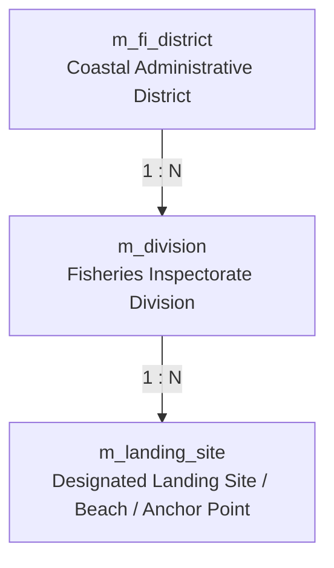
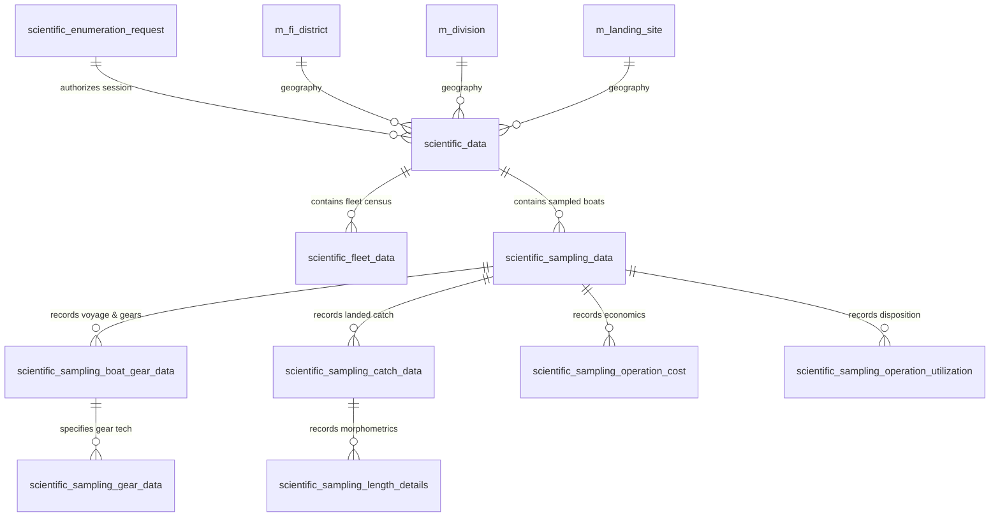
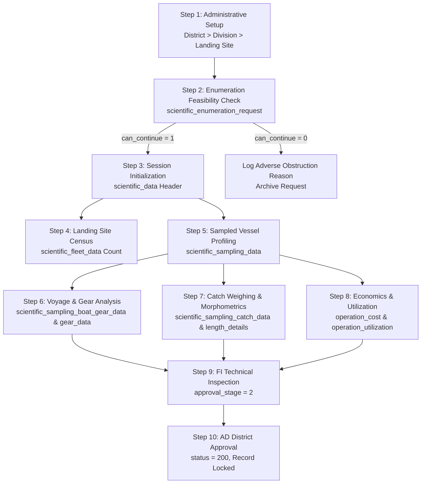

# Department of Fisheries and Aquatic Resources (DFAR)
# Comprehensive Database Documentation

---

### Executive Document Summary
- **Document Code**: DFAR-DOC-DB-MASTER
- **System**: Department of Fisheries and Aquatic Resources Management System (DFAR-MS)
- **Target Audience**: Senior Directorate, Database Administrators (DBAs), Systems Architects, Software Engineers, and Data Analysts
- **Core Coverage**:
  1. **Database Structures and Schemas** (Physical architecture, core registries, district/division/landing site hierarchy, and all 10 Scientific Enumeration tables)
  2. **Data Dictionaries and Metadata** (Field specifications, data types, precision, nullability, keys, default values, identifier regex formats, and controlled vocabularies)
  3. **Data Workflow Descriptions** (End-to-end data lifecycle, feasibility requests, landing site census, sampling boat profiles, catch morphometrics, economics, multi-tier approvals, and state machine diagrams)
  4. **Data-Access Procedures** (Yii2 PDO architecture, ActiveRecord vs QueryBuilder patterns, ACID transaction management, concurrency locking, injection prevention, RBAC row filtering, and DBA maintenance governance)

---

# Section 1: Database Structures and Schemas

## 1.1 Physical & Logical Database Architecture

The DFAR Management System database is implemented on **MySQL 8.0+ / MariaDB 10.6+** utilizing the high-performance **InnoDB Storage Engine**.

```
+---------------------------------------------------------------------------------------+
|                                    DFAR DATABASE                                      |
|                               Character Set: utf8mb4                                  |
|                             Collation: utf8mb4_unicode_ci                             |
|                                Storage Engine: InnoDB                                 |
+---------------------------------------------------------------------------------------+
|  Administrative Lookups   |  User & Access Control  |   Fleet & Registrations   |
|  - m_fi_district          |  - user                 |   - vessel_registration   |
|  - m_division             |  - profile_officer      |   - boat_numbers          |
|  - m_landing_site         |  - auth_item            |   - licenses              |
|  - master_boat_type       |  - auth_assignment      |   - skipper_details       |
+---------------------------------------------------------------------------------------+
|                       SCIENTIFIC SAMPLING & ENUMERATION CLUSTER                      |
|  1. scientific_enumeration_request    6. scientific_sampling_data                     |
|  2. scientific_data                   7. scientific_sampling_gear_data                |
|  3. scientific_fleet_data             8. scientific_sampling_length_details           |
|  4. scientific_sampling_boat_gear_data9. scientific_sampling_operation_cost           |
|  5. scientific_sampling_catch_data    10. scientific_sampling_operation_utilization   |
+---------------------------------------------------------------------------------------+
```

### Physical Storage & ACID Configuration
- **Transaction Isolation Level**: `READ COMMITTED` (guarantees consistent non-blocking snapshot reads and avoids dirty reads).
- **Primary Key Paradigm**: Monotonically increasing `INT` / `BIGINT` `AUTO_INCREMENT` Clustered Indexes to prevent InnoDB page splits.
- **Foreign Key Integrity**: Enforced via explicit `FOREIGN KEY ... REFERENCES ... ON UPDATE CASCADE ON DELETE RESTRICT` constraints to prevent orphan statistical records.
- **Buffer Pool**: 70-80% of host RAM dedicated to `innodb_buffer_pool_size` ensuring hot indices remain in-memory.

---

## 1.2 Administrative Geographic Hierarchy Schemas

The fisheries administrative structure in Sri Lanka is strictly hierarchical: **District -> Division -> Landing Site**.



### 1.2.1 `m_fi_district` (District Master)
Defines the coastal and inland administrative fisheries districts across Sri Lanka (e.g., Colombo, Galle, Matara, Kalutara, Jaffna, Trincomalee, Batticaloa).

| Column | Data Type | Nullable | Default | Key | Description |
| :--- | :--- | :---: | :---: | :---: | :--- |
| `id` | `int` | NO | Auto Inc | **PK** | Unique District Identifier |
| `district_name` | `varchar(150)` | NO | NULL | **UK** | Official District Name (English) |
| `district_code` | `varchar(10)` | NO | NULL | **UK** | Standard 3-letter code (e.g. `COL`, `GAL`, `JAF`) |
| `province_id` | `int` | YES | NULL | **FK** | Provincial administrative link |
| `status` | `smallint` | NO | 10 | | District operational status (10=Active, 0=Inactive) |
| `created_at` | `timestamp` | NO | CURRENT_TIMESTAMP | | Audit creation timestamp |

### 1.2.2 `m_division` (Fisheries Division Master)
Defines the Fisheries Inspector (FI) divisions within each administrative district.

| Column | Data Type | Nullable | Default | Key | Description |
| :--- | :--- | :---: | :---: | :---: | :--- |
| `id` | `int` | NO | Auto Inc | **PK** | Unique Division Identifier |
| `district_id` | `int` | NO | NULL | **FK** | Reference to `m_fi_district.id` |
| `division_name` | `varchar(150)` | NO | NULL | | Official Division Name (e.g. Negombo, Beruwala) |
| `division_code` | `varchar(20)` | YES | NULL | **IDX** | Division administrative abbreviation |
| `status` | `smallint` | NO | 10 | | Operational status (10=Active, 0=Inactive) |

### 1.2.3 `m_landing_site` (Designated Landing Site Master)
Catalog of registered fish landing centers, fishery harbours, anchor points, and beach seine stations.

| Column | Data Type | Nullable | Default | Key | Description |
| :--- | :--- | :---: | :---: | :---: | :--- |
| `id` | `int` | NO | Auto Inc | **PK** | Unique Landing Site Identifier |
| `district_id` | `int` | NO | NULL | **FK** | Reference to `m_fi_district.id` |
| `division_id` | `int` | NO | NULL | **FK** | Reference to `m_division.id` |
| `site_name` | `varchar(200)` | NO | NULL | | Name of the landing center / harbour |
| `site_code` | `varchar(30)` | YES | NULL | **IDX** | Landing site identification code |
| `site_type` | `varchar(50)` | YES | 'Beach'| | Facility type (Harbour, Anchorage, Beach Seine, River Mouth) |
| `latitude` | `decimal(10,8)`| YES | NULL | | GPS WGS84 Latitude |
| `longitude` | `decimal(11,8)`| YES | NULL | | GPS WGS84 Longitude |
| `status` | `smallint` | NO | 10 | | Active status (10=Active, 0=Closed) |

---

## 1.3 Core Identity & User Access Schemas

### 1.3.1 `user` (Authentication Accounts)
| Column | Data Type | Nullable | Default | Key | Description |
| :--- | :--- | :---: | :---: | :---: | :--- |
| `id` | `int` | NO | Auto Inc | **PK** | Unique User Identifier |
| `nic` | `varchar(255)` | NO | NULL | **UK** | National Identity Card / Username |
| `auth_key` | `varchar(32)` | NO | NULL | | Auto-login cookie verification key |
| `password_hash` | `varchar(255)` | NO | NULL | | Bcrypt password hash |
| `email` | `varchar(255)` | NO | NULL | **UK** | Official communications email address |
| `type` | `varchar(20)` | NO | '0' | **IDX** | Role Type: 1=Fisherman, 2=FI, 3=AD, 4=DG, 5=DO/Enumerator, 11=Admin |
| `profile_id` | `int` | NO | 0 | | Pointer to specific profile table |
| `status` | `smallint` | NO | 10 | | Account State (10=Active, 9=Inactive, 0=Deleted) |
| `failed_login_attempts` | `int` | NO | 0 | | Counter triggering progressive lockout |
| `locked_until` | `int` | YES | NULL | | Lockout expiration epoch timestamp |
| `created_at` | `int` | NO | NULL | | Account creation Unix epoch |
| `updated_at` | `int` | NO | NULL | | Last account update Unix epoch |

### 1.3.2 `profile_officer` (Departmental Personnel Profiles)
| Column | Data Type | Nullable | Default | Key | Description |
| :--- | :--- | :---: | :---: | :---: | :--- |
| `id` | `int` | NO | Auto Inc | **PK** | Unique Profile Identifier |
| `first_name` | `varchar(200)` | NO | NULL | | Officer First Name |
| `last_name` | `varchar(200)` | NO | NULL | | Officer Surname |
| `nic` | `varchar(20)` | YES | NULL | **UK** | National Identity Card Number |
| `current_designation` | `varchar(100)` | YES | NULL | | Official Title (e.g. Statistical Enumerator, FI, AD) |
| `district` | `int` | YES | NULL | **FK** | Assigned District (`m_fi_district.id`) |
| `division` | `int` | YES | NULL | **FK** | Assigned Division (`m_division.id`) |
| `user_level` | `varchar(50)` | NO | 'Field'| | Operational Clearance Level |
| `status` | `int` | NO | 10 | | Profile status |

---

## 1.4 The 10 Core Scientific Enumeration & Sampling Schemas

The scientific sampling cluster is the statistical foundation of DFAR, adhering to international **IOTC (Indian Ocean Tuna Commission)** and **FAO** sampling guidelines.



---

### Table 1: `scientific_enumeration_request`
*Purpose: Determines whether an enumerator can carry out sampling on a given date and site, or documents obstruction reasons.*

| Column | Data Type | Nullable | Default | Key | Description |
| :--- | :--- | :---: | :---: | :---: | :--- |
| `id` | `int` | NO | Auto Inc | **PK** | Unique request record identifier |
| `user` | `int` | NO | NULL | **FK** | User ID of the enumerator (`user.id`) |
| `request_date` | `date` | NO | NULL | **IDX** | System date when request was logged |
| `date` | `date` | NO | NULL | | Scheduled date of proposed sampling |
| `district` | `int` | NO | NULL | **FK** | District targeted (`m_fi_district.id`) |
| `division` | `int` | NO | NULL | **FK** | Division targeted (`m_division.id`) |
| `landing_site` | `int` | NO | NULL | **FK** | Target landing site (`m_landing_site.id`) |
| `can_continue` | `tinyint(1)` | NO | 1 | | Feasibility flag (1 = Yes, 0 = Cannot carry out) |
| `reason` | `text` | YES | NULL | | Reason if unable to sample (adverse weather, strike, no boats landed) |
| `status` | `int` | NO | 1 | | State code (1=Pending, 2=Approved by FI, 3=Rejected) |

---

### Table 2: `scientific_data`
*Purpose: Header and master record of a completed landing site enumeration session.*

| Column | Data Type | Nullable | Default | Key | Description |
| :--- | :--- | :---: | :---: | :---: | :--- |
| `id` | `int` | NO | Auto Inc | **PK** | Unique enumeration session ID |
| `district` | `int` | NO | NULL | **FK** | District of enumeration (`m_fi_district.id`) |
| `division` | `int` | NO | NULL | **FK** | Division of enumeration (`m_division.id`) |
| `landing_site` | `int` | NO | NULL | **FK** | Landing site sampled (`m_landing_site.id`) |
| `start_time` | `datetime` | NO | NULL | | Observation start timestamp at the beach/harbour |
| `end_time` | `datetime` | NO | NULL | | Observation end timestamp at the beach/harbour |
| `added_by` | `int` | NO | NULL | **FK** | Enumerator user account (`user.id`) |
| `status` | `int` | NO | 1 | **IDX** | Status flag (1=Draft, 10=Submitted, 200=Approved) |
| `approval_stage` | `int` | NO | 1 | | Approval tier (1=Field, 2=FI Inspected, 3=AD District Endorsement) |
| `inspected_by` | `int` | YES | NULL | **FK** | Officer ID who verified field data (`user.id`) |

---

### Table 3: `scientific_fleet_data`
*Purpose: Summary census of all boats operated and landed at the landing site during the enumeration session.*

| Column | Data Type | Nullable | Default | Key | Description |
| :--- | :--- | :---: | :---: | :---: | :--- |
| `id` | `int` | NO | Auto Inc | **PK** | Unique fleet record ID |
| `scientific_data_id`| `int` | NO | NULL | **FK** | Session foreign key (`scientific_data.id`) |
| `boat_type` | `int` | NO | NULL | **FK** | Craft category (`master_boat_type.id`) (NBSB, OFRP, IDB, IMUL) |
| `sub_category` | `varchar(100)`| YES | NULL | | Technical sub-type (e.g. 28ft inboard, 19ft outboard) |
| `gear_type` | `int` | NO | NULL | **FK** | Main fishing gear used (`m_gear.id`) |
| `no_of_boats` | `int` | NO | 0 | | Count of active boats observed operating |
| `status` | `int` | NO | 1 | | Verification status flag |

---

### Table 4: `scientific_sampling_data`
*Purpose: Registration and identification details of an individually sampled vessel selected for detailed catch and gear analysis.*

| Column | Data Type | Nullable | Default | Key | Description |
| :--- | :--- | :---: | :---: | :---: | :--- |
| `id` | `int` | NO | Auto Inc | **PK** | Unique vessel sample record ID |
| `scientific_data_id`| `int` | NO | NULL | **FK** | Master session reference (`scientific_data.id`) |
| `boat_reg_no` | `varchar(50)` | NO | NULL | **IDX** | Official DFAR vessel registration / MEA plate number |
| `boat_name` | `varchar(150)`| YES | NULL | | Vessel commercial or vernacular name |
| `skipper_name` | `varchar(200)`| YES | NULL | | Name of vessel master / skipper on voyage |
| `status` | `int` | NO | 1 | | Record validation status |

---

### Table 5: `scientific_sampling_boat_gear_data`
*Purpose: Nautical voyage profile, engine specifications, departure/arrival tracking, and sea conditions for the sampled boat.*

| Column | Data Type | Nullable | Default | Key | Description |
| :--- | :--- | :---: | :---: | :---: | :--- |
| `id` | `int` | NO | Auto Inc | **PK** | Unique sampling boat gear record ID |
| `sampling_data_id` | `int` | NO | NULL | **FK** | Vessel reference (`scientific_sampling_data.id`) |
| `fishery_type` | `varchar(100)`| YES | NULL | | Fishing domain (Coastal, Offshore, Highseas) |
| `sub_category` | `varchar(100)`| YES | NULL | | Specific vessel sub-class |
| `engine_hp` | `decimal(6,2)`| YES | NULL | | Engine power in Horsepower (HP) |
| `departure_date` | `date` | YES | NULL | | Date vessel departed from port |
| `departure_time` | `time` | YES | NULL | | Time vessel departed from port |
| `departure_district`| `int` | YES | NULL | **FK** | District of departure (`m_fi_district.id`) |
| `departure_division`| `int` | YES | NULL | **FK** | Division of departure (`m_division.id`) |
| `depature_port` | `varchar(150)`| YES | NULL | | Departure port / anchorage name |
| `arrival_date` | `date` | YES | NULL | | Date vessel landed catch |
| `weather` | `varchar(100)`| YES | NULL | | Sea weather state (Calm, Moderate, Rough, Stormy) |
| `remark` | `text` | YES | NULL | | Field officer observations |
| `crew_members_count`| `int` | YES | 1 | | Total number of crew onboard |
| `unloading_type` | `varchar(100)`| YES | NULL | | Unloading method (Manual baskets, crane, conveyor) |
| `gear_setting_time`| `time` | YES | NULL | | Time gear was deployed into water |
| `days` | `int` | YES | 0 | | Total fishing trip duration (days at sea) |
| `hours` | `decimal(5,2)`| YES | 0 | | Voyage hours at sea |
| `status` | `int` | NO | 1 | | Data verification status |

---

### Table 6: `scientific_sampling_gear_data`
*Purpose: Technical specifications of fishing gears deployed by the sampled vessel and actual fishing effort applied.*

| Column | Data Type | Nullable | Default | Key | Description |
| :--- | :--- | :---: | :---: | :---: | :--- |
| `id` | `int` | NO | Auto Inc | **PK** | Unique gear sample record ID |
| `sampling_boat_gear_id`| `int` | NO | NULL | **FK** | Reference to `scientific_sampling_boat_gear_data.id` |
| `gear_type` | `int` | NO | NULL | **FK** | Classified gear type (`m_gear.id`) |
| `mesh_size_mm` | `decimal(6,2)`| YES | NULL | | Net mesh size in millimeters |
| `length_m` | `decimal(8,2)`| YES | NULL | | Total gear length in meters |
| `height_m` | `decimal(6,2)`| YES | NULL | | Net height / drop in meters |
| `no_of_hooks` | `int` | YES | NULL | | Total hooks deployed (for Longline / Handline) |
| `soaking_time_hours`| `decimal(5,2)`| YES | NULL | | Time gear remained immersed fishing |
| `status` | `int` | NO | 1 | | Gear verification status |

---

### Table 7: `scientific_sampling_catch_data`
*Purpose: Disaggregated catch log recording landed species, total weight, specimen count, and landing state.*

| Column | Data Type | Nullable | Default | Key | Description |
| :--- | :--- | :---: | :---: | :---: | :--- |
| `id` | `int` | NO | Auto Inc | **PK** | Unique catch record ID |
| `sampling_data_id` | `int` | NO | NULL | **FK** | Sampled vessel reference (`scientific_sampling_data.id`) |
| `species_id` | `int` | NO | NULL | **FK** | Marine species identifier (`m_species.id`) |
| `gear_id` | `int` | YES | NULL | **FK** | Gear that caught the species (`m_gear.id`) |
| `total_weight_kg` | `decimal(10,2)`| NO | 0.00 | | Landed weight in kilograms |
| `total_count` | `int` | YES | NULL | | Number of individual specimens caught |
| `form_code` | `varchar(20)` | YES | 'WHO' | | Processing state: Whole (WHO), Gutted (GUT), G&G (GG) |
| `status` | `int` | NO | 1 | | Catch validation status |

---

### Table 8: `scientific_sampling_length_details`
*Purpose: Individual specimen biological morphometrics (length frequency distributions) for stock assessment modeling.*

| Column | Data Type | Nullable | Default | Key | Description |
| :--- | :--- | :---: | :---: | :---: | :--- |
| `id` | `int` | NO | Auto Inc | **PK** | Unique specimen measurement ID |
| `catch_data_id` | `int` | NO | NULL | **FK** | Parent catch record (`scientific_sampling_catch_data.id`) |
| `length_cm` | `decimal(6,2)`| NO | NULL | | Measured specimen length in centimeters |
| `length_type` | `varchar(10)` | NO | 'FL' | | Measurement type: FL (Fork Length), TL (Total Length), SL (Standard Length), CL (Carapace Length) |
| `weight_g` | `decimal(8,2)`| YES | NULL | | Specimen individual weight in grams |
| `sex` | `varchar(10)` | YES | 'U' | | Sex determination: Male (M), Female (F), Unknown (U) |
| `status` | `int` | NO | 1 | | Biometric verification status |

---

### Table 9: `scientific_sampling_operation_cost`
*Purpose: Economic metrics of the fishing voyage to assess boat owner profitability and fishery socio-economics.*

| Column | Data Type | Nullable | Default | Key | Description |
| :--- | :--- | :---: | :---: | :---: | :--- |
| `id` | `int` | NO | Auto Inc | **PK** | Unique operational cost record ID |
| `sampling_data_id` | `int` | NO | NULL | **FK** | Sampled vessel reference (`scientific_sampling_data.id`) |
| `fuel_cost_lkr` | `decimal(12,2)`| YES | 0.00 | | Diesel / Kerosene fuel expenditure in Sri Lankan Rupees |
| `ice_cost_lkr` | `decimal(12,2)`| YES | 0.00 | | Crushed ice purchase expenditure |
| `bait_cost_lkr` | `decimal(12,2)`| YES | 0.00 | | Live / frozen bait cost |
| `food_provisions_lkr`| `decimal(12,2)`| YES | 0.00 | | Crew food, water, and voyage provisions |
| `labour_crew_cost_lkr`| `decimal(12,2)`| YES | 0.00 | | Crew remuneration / wage advance / shares paid |
| `other_costs_lkr` | `decimal(12,2)`| YES | 0.00 | | Port dues, unloading charges, engine lube |
| `status` | `int` | NO | 1 | | Financial audit validation status |

---

### Table 10: `scientific_sampling_operation_utilization`
*Purpose: Post-harvest catch commercial disposition tracking (value addition, exports, discards, and local markets).*

| Column | Data Type | Nullable | Default | Key | Description |
| :--- | :--- | :---: | :---: | :---: | :--- |
| `id` | `int` | NO | Auto Inc | **PK** | Unique utilization record ID |
| `sampling_data_id` | `int` | NO | NULL | **FK** | Sampled vessel reference (`scientific_sampling_data.id`) |
| `species_id` | `int` | NO | NULL | **FK** | Marine species identifier (`m_species.id`) |
| `export_fresh_kg` | `decimal(10,2)`| YES | 0.00 | | Landed volume sold for fresh commercial air export |
| `export_frozen_kg` | `decimal(10,2)`| YES | 0.00 | | Landed volume directed to commercial blast freezing |
| `local_fresh_market_kg`| `decimal(10,2)`| YES | 0.00 | | Sold at domestic retail/wholesale fresh markets |
| `dried_salting_kg` | `decimal(10,2)`| YES | 0.00 | | Directed to beach drying, salting, or Maldive fish |
| `discards_at_sea_kg`| `decimal(10,2)`| YES | 0.00 | | Damaged / unmarketable catch discarded at sea |
| `trash_animal_feed_kg`| `decimal(10,2)`| YES | 0.00 | | Sold for fish meal, aquaculture feed, or fertilizer |
| `average_price_per_kg`| `decimal(10,2)`| YES | 0.00 | | Average farm-gate / beach auction price (LKR/kg) |
| `status` | `int` | NO | 1 | | Utilization record status |

---

# Section 2: Data Dictionaries and Metadata

## 2.1 Metadata Principles & Standards
The DFAR metadata architecture complies with **ISO/IEC 11179 Information Technology Metadata Registries**:
1. **Self-Documenting Identifiers**: Every attribute follows `snake_case` with unambiguous semantic nouns (e.g. `departure_district`, `mesh_size_mm`, `total_weight_kg`).
2. **Standard Units of Measure**:
   - Weights: Kilograms (`kg`) in 2 decimal places (`DECIMAL(10,2)`), grams (`g`) for biological morphometrics (`DECIMAL(8,2)`).
   - Lengths: Centimeters (`cm`) for fish sizes (`DECIMAL(6,2)`), millimeters (`mm`) for gear mesh (`DECIMAL(6,2)`), meters (`m`) for net lengths (`DECIMAL(8,2)`).
   - Currency: Sri Lankan Rupees (`LKR`) in 2 decimal places (`DECIMAL(12,2)`).
   - Coordinates: WGS84 Decimal Degrees (`DECIMAL(10,8)` Latitude, `DECIMAL(11,8)` Longitude).
   - Timestamps: UTC/Asia-Colombo aligned ISO-8601 (`YYYY-MM-DD HH:MM:SS`).

---

## 2.2 Canonical Business Identifier Formatting Schemas

Every government-issued credential and transaction record is constrained by formal regular expression validation rules:

| Identifier Entity | Formal Structure | Regular Expression | Real-World Production Example |
| :--- | :--- | :--- | :--- |
| **Fisherman ID** | `FM{serial}{district}` | `^FM\d{3,6}[A-Z]{3}$` | `FM1042COL` |
| **Skipper Card** | `SK{serial}{district}` | `^SK\d{3,6}[A-Z]{3}$` | `SK0589GAL` |
| **MEA Vessel Plate** | `{year}/{type}-{dist}-{id}`| `^\d{4}\/[A-Z0-9-]+\d+$` | `2026/IMUL-COL-441` |
| **EEZ Coastal License** | `{year}EEZ{craft}{num}{dist}`| `^\d{4}EEZ[A-Z]{3,5}\d{3,6}[A-Z]{3}$`| `2026EEZOFRP0412COL` |
| **Highseas (IMUL) License**| `{year}HSIMUL{num}{dist}` | `^\d{4}HSIMUL\d{3,6}[A-Z]{3}$` | `2026HSIMUL0089GAL` |
| **Scientific Session Code** | `SCI-{YYYYMMDD}-{SITE}-{ID}`| `^SCI-\d{8}-[A-Z0-9]{3,8}-\d+$` | `SCI-20261013-BER-0082` |

---

## 2.3 Master Controlled Vocabularies & System Enumerations

### 2.3.1 User Role Classifications (`user.type`)
| Type ID | Internal Constant | Designation / Role | Operational Scope |
| :---: | :--- | :--- | :--- |
| `1` | `Constant::FISHERMAN` | Fisherman / Vessel Owner | Self-service vessel registration & license requests |
| `2` | `Constant::FI` | Fisheries Inspector (FI) | Division inspections, sampling validation & recommendations |
| `3` | `Constant::AD` | Assistant Director (AD) | District administration, scientific endorsements & licenses |
| `4` | `Constant::DG` | Director General (DG) | Executive governance, national quotas & policy decrees |
| `5` | `Constant::DO` | Development Officer / Enumerator | Field-level beach enumeration & catch sampling |
| `11` | `Constant::ADMIN` | IT System Administrator | User provisioning, RBAC definitions & database audits |

### 2.3.2 Regulatory Record Statuses (`status`)
| Status Code | Verbal State | Semantic Meaning & Database Governance Rule |
| :---: | :--- | :--- |
| `1` | **Draft / Pending** | Record entered by enumerator/officer; editable; not yet legally endorsed. |
| `2` | **Verified / Inspected**| Inspected and approved by the territorial Fisheries Inspector. |
| `10` | **Active / Standard** | Standard production active status for users, vessels, and master lookups. |
| `200` | **Approved / Completed**| Formally finalized by Assistant Director; locks record against changes. |
| `0` | **Rejected / Archived** | Cancelled or superseded record; soft-deleted from operational views. |

### 2.3.3 Fishing Gear Classification Codes (`m_gear.id`)
Standardized internationally aligned FAO / IOTC fishing gear categories:
- `GN` - Drift Gillnet
- `LLS` - Surface Longline (Pelagic Tuna Longline)
- `LLD` - Deep Longline (Bottom Longline)
- `PS` - Purse Seine
- `RS` - Ring Net
- `TR` - Fish Trap / Pot
- `HL` - Handline / Pole and Line
- `BS` - Beach Seine

### 2.3.4 Marine Vessel Categories (`master_boat_type.id`)
- `NBSB` - Non-Motorized Traditional Boat (Outrigger / Canoe)
- `OFRP` - Outboard Engine Fiberglass Reinforced Plastic Boat (18-23 ft)
- `MTRB` - Motorized Traditional Boat
- `IDB` - Day Boat with Inboard Engine (28-32 ft, single-day trips)
- `IMUL` - Multi-Day Inboard Vessel (34-60+ ft, equipped with insulated fish holds/freezers)

### 2.3.5 Fish Morphometric Length Types (`length_type`)
- `FL` - **Fork Length**: Tip of snout to fork of the tail fin (Tunas, Mackerels, Billfish).
- `TL` - **Total Length**: Tip of snout to furthest tip of tail fin pressed together (Sharks, Demersals).
- `SL` - **Standard Length**: Tip of snout to end of the caudal peduncle / vertebral column.
- `CL` - **Carapace Length**: Anterior margin to posterior margin of carapace (Lobsters, Crabs).

---

# Section 3: Data Workflow Descriptions

The life of data within the DFAR database follows a disciplined lifecycle of collection, validation, verification, hierarchical endorsement, and immutable archival.



---

## 3.1 Step-by-Step Data Lifecycles

### Workflow 1: Master Administrative Setup & Geographic Binding
1. **Trigger**: District office commissions a new landing facility or administrative boundary change.
2. **Database Progression**:
   - DBA or Head Office Admin provisions `m_fi_district` -> inserts `m_division` -> inserts `m_landing_site`.
   - GPS coordinates (`latitude`, `longitude`) are geocoded and validated.
   - Profile links in `profile_officer` are mapped to territory IDs to enforce row-level jurisdiction filters.

### Workflow 2: Enumerator Daily Feasibility Assessment
1. **Trigger**: Enumerator arrives at the designated landing site in the morning.
2. **Database Progression**:
   - Application inserts record into `scientific_enumeration_request` with `request_date`, `date`, `user`, `district`, `division`, `landing_site`.
   - If conditions permit sampling: `can_continue = 1`, `status = 1`.
   - If sampling is obstructed (rough sea, fleet in harbour, communal strike): `can_continue = 0`, field `reason` populated with description, `status = 1`.

### Workflow 3: Landing Site Session Initialization
1. **Trigger**: Feasibility is positive; sampling session begins.
2. **Database Progression**:
   - Record created in `scientific_data` with `start_time = NOW()`, `added_by = current_user_id`, `status = 1` (Draft), `approval_stage = 1`.
   - System locks active session context in the enumerator client interface.

### Workflow 4: Total Landing Site Fleet Census
1. **Trigger**: Enumerator tallies all vessels landing at the beach/wharf during the observation window.
2. **Database Progression**:
   - Aggregated counts inserted into `scientific_fleet_data` grouped by `boat_type`, `sub_category`, and `gear_type`.
   - Provides raising factor denominator for total fishery production estimation.

### Workflow 5: Sampled Vessel Identification & Voyage Tracking
1. **Trigger**: Specific vessel selected using systematic random sampling.
2. **Database Progression**:
   - Insert into `scientific_sampling_data` with `boat_reg_no`, `boat_name`, `skipper_name`.
   - Insert into `scientific_sampling_boat_gear_data`:
     - Nautical parameters: `departure_date`, `departure_time`, `arrival_date`, `depature_port`, `crew_members_count`.
     - Effort parameters: `days`, `hours`, `gear_setting_time`, `weather`.
   - Detailed gear attributes inserted into `scientific_sampling_gear_data` (`mesh_size_mm`, `no_of_hooks`, `length_m`, `soaking_time_hours`).

### Workflow 6: Catch Composition & Morphometric Length Sampling
1. **Trigger**: Landed catch sorted by species on the landing quay.
2. **Database Progression**:
   - For each species: insert record into `scientific_sampling_catch_data` (`species_id`, `gear_id`, `total_weight_kg`, `total_count`, `form_code`).
   - For sampled specimens: insert individual biometric rows into `scientific_sampling_length_details` (`catch_data_id`, `length_cm`, `length_type`, `weight_g`, `sex`).

### Workflow 7: Voyage Economics & Catch Commercial Disposition
1. **Trigger**: Enumerator interviews skipper/owner regarding operational costs and catch sales.
2. **Database Progression**:
   - Financial entry in `scientific_sampling_operation_cost` (`fuel_cost_lkr`, `ice_cost_lkr`, `bait_cost_lkr`, `food_provisions_lkr`, `labour_crew_cost_lkr`).
   - Utilization breakdown in `scientific_sampling_operation_utilization` (`export_fresh_kg`, `export_frozen_kg`, `local_fresh_market_kg`, `dried_salting_kg`, `discards_at_sea_kg`, `average_price_per_kg`).

### Workflow 8: Quality Control, Multi-Tier Endorsement & Archival
1. **Trigger**: Enumerator completes session; submits data.
2. **Database Progression**:
   - Enumerator triggers submit: `scientific_data.end_time = NOW()`, `status = 10` (Submitted).
   - Division FI reviews data: updates `approval_stage = 2`, `inspected_by = fi_user_id`.
   - District Assistant Director (AD) reviews and signs off: updates `status = 200` (Approved), `approval_stage = 3`.
   - Record becomes strictly **READ-ONLY**; modifications rejected by application-level validation and audit triggers.

---

# Section 4: Data-Access Procedures

## 4.1 Application-Level Data Access Architecture

Data access in the DFAR Management System is mediated through the **Yii2 Database Abstraction Layer** using **PHP Data Objects (PDO)**. Direct raw SQL execution with untrusted parameters is strictly prohibited.

```
+---------------------------------------------------------------------------------------+
|  User Interface (Controllers)                                                         |
|  - ScientificController / SiteController / VesselController                           |
+---------------------------------------------------------------------------------------+
                                           |
                                           v
+---------------------------------------------------------------------------------------+
|  Business Domain Layer (ActiveRecord Models)                                         |
|  - ScientificData::find() / ScientificSamplingCatchData::save()                       |
+---------------------------------------------------------------------------------------+
                                           |
                                           v
+---------------------------------------------------------------------------------------+
|  Yii2 DB Layer & Query Builder (PDO Prepared Statements)                              |
|  - Parameter Binding (:id, :status) & Connection Pool                                 |
+---------------------------------------------------------------------------------------+
                                           |
                                           v
+---------------------------------------------------------------------------------------+
|  MySQL 8.0 InnoDB Database (InnoDB Buffer Pool & Read Committed Isolation)            |
+---------------------------------------------------------------------------------------+
```

---

## 4.2 Standard Query & Read Optimization Procedures

### 4.2.1 Prevention of N+1 Query Traps (Eager Loading)
To achieve sub-50ms query latency, all relational joins across the sampling hierarchy MUST use eager loading via `with()`:

```php
// Standard Compliant Eager Loading Procedure
$samplingSessions = ScientificData::find()
    ->with([
        'districtRelation',
        'divisionRelation',
        'landingSiteRelation',
        'fleetData',
        'samplingBoats.boatGearData.gears',
        'samplingBoats.catchData.lengthDetails',
        'samplingBoats.operationCosts',
        'samplingBoats.operationUtilizations'
    ])
    ->where(['district' => $officerDistrictId])
    ->andWhere(['status' => Constant::STATUS_APPROVED])
    ->orderBy(['start_time' => SORT_DESC])
    ->limit(50)
    ->all();
```

### 4.2.2 High-Volume Cursor Pagination for Reporting
When processing large multi-year catch logs (exceeding 100,000 rows) for IOTC reporting, cursor batches (`batch()` or `each()`) must be used to preserve memory:

```php
// Batch Processing Pattern
foreach (ScientificSamplingCatchData::find()->with('species')->batch(500) as $catchRows) {
    foreach ($catchRows as $catch) {
        $iotcExporter->processRow($catch);
    }
}
```

---

## 4.3 Transactional Write Operations & Atomic Persistence

Multi-table inserts (e.g. creating a sampling session with child boats, gears, catches, and length measurements) MUST be wrapped in explicit **ACID Database Transactions**:

```php
// Transactional Persistence Procedure
$transaction = Yii::$app->db->beginTransaction();
try {
    // 1. Persist Master Session
    $session = new ScientificData();
    $session->attributes = $postData['ScientificData'];
    $session->status = Constant::STATUS_DRAFT;
    if (!$session->save()) {
        throw new \Exception('Failed to save master session: ' . json_encode($session->errors));
    }

    // 2. Persist Fleet Summary Records
    foreach ($postData['FleetData'] as $fleetItem) {
        $fleet = new ScientificFleetData();
        $fleet->scientific_data_id = $session->id;
        $fleet->attributes = $fleetItem;
        if (!$fleet->save()) {
            throw new \Exception('Failed to save fleet row');
        }
    }

    // 3. Persist Sampled Boats & Catch Chains
    foreach ($postData['Vessels'] as $vesselItem) {
        $vessel = new ScientificSamplingData();
        $vessel->scientific_data_id = $session->id;
        $vessel->attributes = $vesselItem;
        if (!$vessel->save()) {
            throw new \Exception('Failed to save vessel row');
        }

        // Persist Voyage & Gear Details
        $boatGear = new ScientificSamplingBoatGearData();
        $boatGear->sampling_data_id = $vessel->id;
        $boatGear->attributes = $vesselItem['GearDetails'];
        $boatGear->save();

        // Persist Catches and Biometrics
        foreach ($vesselItem['Catches'] as $catchItem) {
            $catch = new ScientificSamplingCatchData();
            $catch->sampling_data_id = $vessel->id;
            $catch->attributes = $catchItem;
            $catch->save();

            foreach ($catchItem['Lengths'] as $lengthVal) {
                $specimen = new ScientificSamplingLengthDetails();
                $specimen->catch_data_id = $catch->id;
                $specimen->length_cm = $lengthVal['cm'];
                $specimen->length_type = $lengthVal['type'];
                $specimen->save();
            }
        }
    }

    $transaction->commit();
    return ['status' => 'success', 'session_id' => $session->id];
} catch (\Exception $e) {
    $transaction->rollBack();
    Yii::error("Scientific Session Write Aborted: " . $e->getMessage(), __METHOD__);
    throw $e;
}
```

---

## 4.4 Concurrency Control & Row-Level Locking

To prevent race conditions during quota decrements or status approval transitions, **Pessimistic Locking** (`FOR UPDATE`) is enforced:

```php
// Pessimistic Locking Pattern for Status Transition
$session = ScientificData::findBySql(
    "SELECT * FROM scientific_data WHERE id = :id FOR UPDATE",
    [':id' => $sessionId]
)->one();

if ($session && $session->approval_stage === 2) {
    $session->approval_stage = 3;
    $session->status = Constant::STATUS_APPROVED;
    $session->save();
}
```

---

## 4.5 SQL Injection Prevention & Parameter Binding Standards

1. **Mandatory PDO Placeholders**: Direct concatenation of PHP variables inside SQL clauses is prohibited.
   - **Allowed**: `->where(['district' => $districtId])` or `->andWhere('start_time >= :start', [':start' => $startDate])`
   - **Prohibited**: `->where("district = " . $districtId)` (Triggers immediate CI/CD build failure).
2. **Type Casting & Model Rules**: All integer foreign keys are validated via `['district', 'integer']` rules in model validation before reaching the database adapter.

---

## 4.6 Row-Level Security (RLS) & Jurisdiction Filtering

Data access is segmented by user role and geographic jurisdiction:
- **Field Enumerator / FI**: Restricted by `profile_officer.district` and `profile_officer.division`. They can only query or insert records belonging to their assigned landing centers.
- **District Assistant Director (AD)**: Can access all divisions and landing sites within their assigned administrative district.
- **Director General / Central Admin**: Unrestricted national read/write access.

```php
// Enforced ActiveQuery Scope
public function applyJurisdictionFilter($query, $user)
{
    if ($user->type === Constant::FI) {
        $profile = ProfileOfficer::findOne(['nic' => $user->nic]);
        $query->andWhere(['division' => $profile->division]);
    } elseif ($user->type === Constant::AD) {
        $profile = ProfileOfficer::findOne(['nic' => $user->nic]);
        $query->andWhere(['district' => $profile->district]);
    }
    return $query;
}
```

---

## 4.7 Direct Database Administrator (DBA) Access Governance

For maintenance, performance optimization, and migrations:
1. **Access Channel**: DBA access is restricted to private SSH tunnels with Key-Based Authentication. Direct exposure of port `3306` to public networks is blocked by firewall.
2. **Privilege Separation**:
   - Web Application User (`dfar_app`): Granted `SELECT`, `INSERT`, `UPDATE`, `DELETE`, `EXECUTE`. No `DROP`, `ALTER`, or `GRANT` permissions.
   - Migration Runner (`dfar_deploy`): Granted DDL rights (`CREATE`, `ALTER`, `INDEX`) executed exclusively through `yii migrate` scripts.
   - Backup Service (`dfar_backup`): Granted `SELECT`, `LOCK TABLES`, `SHOW VIEW`, `RELOAD` for non-blocking logical dumps.
3. **Audit Trails**: All DDL commands, user privilege modifications, and administrative updates are logged in the MySQL Enterprise Audit log and archived for a minimum of 7 years.
