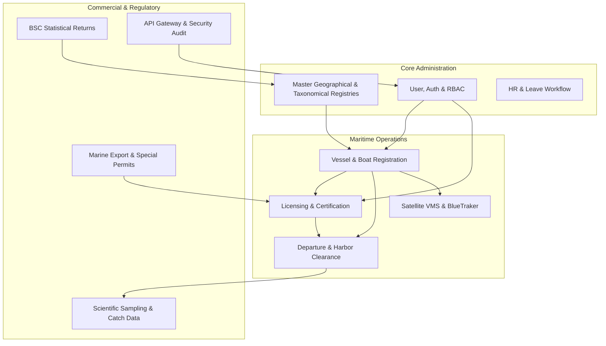

# Department of Fisheries and Aquatic Resources (DFAR)
## Database Architecture Documentation

---

### Document Overview
- **Document Code**: DFAR-DOC-DB-01
- **System**: Department of Fisheries and Aquatic Resources Management System (DFAR-MS)
- **Target Audience**: Senior Database Architects, Lead Developers, Systems Engineers, Audit Officers
- **Database Engine**: MySQL 8.x / 9.x (InnoDB Storage Engine)
- **Database Name**: `dfar_ms`
- **Total Registered Tables**: 166 Tables

---

## 1. Architectural Philosophy & Design Principles

The DFAR-MS database architecture is engineered to provide an authoritative, tamper-evident, national maritime database that manages the entire lifecycle of Sri Lanka's marine fisheries operations. The database supports vessel registrations, multi-tier regulatory licensing (EEZ, Highseas, Special Export permits), crew/skipper credentials, Vessel Monitoring System (VMS) satellite positioning sync, catch enumeration, monthly district statistical returns (BSC1/BSC2), and internal departmental administrative workflows (HR and Leave management).

### Core Architectural Principles
1. **ACID Reliability**: Over 95% of the data structures utilize the **InnoDB** storage engine to guarantee full ACID (Atomicity, Consistency, Isolation, Durability) transaction semantics, row-level locking, and foreign-key referential integrity.
2. **Normalized Relational Model**: 3rd Normal Form (3NF) relational design applied to business entities to prevent redundant data duplication, complemented by controlled denormalization in audit logs and analytical staging tables.
3. **Auditability & Traceability**: Critical regulatory actions (approvals, license status transitions, transfer of ownership, administrative impersonation) write append-only records to dedicated audit structures (`approval_log`, `submission_audit_log`, `boat_number_owners_log`).
4. **Partitioned Responsibility (Bounded Contexts)**: Tables are segregated into discrete operational domains, ensuring modularity and clear separation of concerns across departmental divisions.

---

## 2. Logical Functional Clusters

The 166 tables in the `dfar_ms` schema are organized into 11 logical functional clusters:



### Functional Clusters Detail

| Cluster # | Operational Domain | Table Count | Key Primary Entities | Primary Function |
| :---: | :--- | :---: | :--- | :--- |
| **01** | **User, Identity & RBAC** | 7 | `user`, `auth_item`, `auth_assignment`, `auth_item_child`, `profile_officer`, `profile_fisherman`, `profile_yard` | User authentication, cryptographic credential hashing, role-based permission delegation. |
| **02** | **Vessel & Fleet Registration** | 18 | `boat_numbers`, `boat_number_owners_log`, `boat_number_transfer_request`, `boat_number_cancel_requests`, `boat_design`, `m_boat_category`, `fisherman_registerd_boat` | National vessel registry, unique boat number generation, ownership transfer tracking, vessel cancellation. |
| **03** | **Licensing & Skipper Certifications** | 12 | `national_license`, `highseas_license`, `skipper`, `skipper_renew`, `skipper_tranings`, `special_altereration`, `id_print_queue` | Territorial EEZ licenses, Highseas IMUL licenses, skipper competency cards, card printing spooler. |
| **04** | **Departure & Harbor Logistics** | 8 | `departure_requests`, `departure_boat_activity`, `departure_skipper`, `deparure_request_crew`, `depature_boat_payment` | Harbor departure approvals, mandatory safety checks, crew manifest validations, harbor fees. |
| **05** | **VMS & Satellite Tracking** | 4 | `bluetraker_reports`, `blutracker_api_sync_status`, `vms_payment_...` | Satellite telemetry ingress, vessel coordinates, speed, battery, geofencing violations. |
| **06** | **Scientific Fisheries Sampling & Research** | 18 | `scientific_data`, `scientific_enumeration_request`, `scientific_fleet_data`, `scientific_sampling_data`, `scientific_sampling_boat_gear_data`, `scientific_sampling_gear_data`, `scientific_sampling_catch_data`, `scientific_sampling_length_details`, `scientific_sampling_operation_cost`, `scientific_sampling_operation_utilization`, plus 8 analytical reports (`scientific_catch_report`, `scientific_lw_report`, `scientific_util_report`, `report_scientific_catch2`, `report_scientific_craft`, `report_scientific_craft_gear_wise`, `report_scientific_fleet`, `report_scientific_lw`) | Complete national scientific catch sampling subsystem, biological morphometrics ($W=aL^b$), trip economics, post-harvest market utilization, and research reporting. |
| **07** | **Marine Export & Special Permits** | 14 | `export_company`, `applicationexportbechedemer`, `applicationexportchank`, `applicationexportlivefish`, `applicationexportlobster`, `applicationexportnakla` | Commercial export consignments for high-value marine species (Lobster, Chank, Sea Cucumber, Live Fish). |
| **08** | **BSC Statistical Submissions** | 14 | `bsc1_submissions`, `bsc1_boats`, `bsc1_registrations`, `bsc1_licenses_with_craft`, `bsc1_awareness_programmes`, `bsc2_submissions`, `bsc2_seaworthiness_certs`, `bsc2_lagoon_activities` | Monthly district statistical reporting, compliance verification, deadline extension workflows. |
| **09** | **HR & Leave Workflow** | 9 | `leave`, `leave_approval_history`, `m_approval_workflow`, `approval_log`, `employee`, `salary`, `promotion` | Multi-tier departmental leave approval chain (Applicant -> Acting Officer -> CC -> AD/ITD -> DG). |
| **10** | **Fisheries Administrative & Master Registries** | 30 | `m_fi_district`, `m_division`, `m_landing_site`, `m_harbours`, `m_ds_division`, `m_gs_division`, `m_fish_types`, `m_gear_types`, `m_zone`, `countries`, `banks` | Tri-level Fisheries Inspector administrative hierarchy (`m_fi_district` -> `m_division` -> `m_landing_site`), coastal harbour points, and standardized marine taxonomies. |
| **11** | **API Gateway & Security Logs** | 7 | `api_clients`, `api_keys`, `api_endpoints`, `api_key_permissions`, `api_request_logs`, `fisherman_impersonate_log`, `correction_ignore` | External REST API client management, rate limits, audit trail of administrative impersonations. |

---

## 3. Storage Engine & Character Encoding Standards

### 3.1 Storage Engine Allocation
- **InnoDB (Default)**: Used for all transactional, relational, and foreign-key constrained tables (150+ tables). Handles high concurrency with row-level locking and multi-version concurrency control (MVCC).
- **MyISAM (Legacy/Analytical Staging)**: Utilized on a small subset of legacy reporting staging tables (e.g., `report_scientific_craft`, `system_flags`). All new tables (such as the recent `bsc1_*` and `bsc2_*` migration series) strictly enforce `InnoDB`.

### 3.2 Character Set & Collation
- **Character Set**: `utf8mb4` / `utf8`
- **Collation**: `utf8mb4_unicode_ci` / `utf8_general_ci`
- **Multilingual Support**: Supports trilingual government documentation across **English**, **Sinhala (සිංහල)**, and **Tamil (தமிழ்)** for officer profiles, error descriptions, and public notifications.

---

## 4. Primary Key & Identifier Conventions

| Entity Category | PK Strategy | Business Key Format | Example |
| :--- | :--- | :--- | :--- |
| **Users / Authentication** | `int auto_increment` | `nic` (National Identity Card) | `adminDFAR`, `8457412V`, `198000902817` |
| **Fishermen** | `int auto_increment` | `FM{number}{district_code}` | `FM1042COL` |
| **Skippers** | `int auto_increment` | `SK{number}{district_code}` | `SK084GAL` |
| **National License** | `int auto_increment` | `{year}EEZ{boatType}{number}{dist}` | `2026EEZOFRP0412COL` |
| **Highseas License** | `int auto_increment` | `{year}HSIMUL{number}{district_code}` | `2026HSIMUL0089GAL` |
| **MEA Vessel Registration** | `int auto_increment` | `{year}/{boat}{district_code}{id}` | `2026/IMUL-COL-441` |
| **Error Trace Logs** | UUID / String Key | `ERR-{YYYYMMDD}-{HHMMSS}-{RAND8}` | `ERR-20261013-103536-AYBBTL_O` |

---

## 5. Indexing & Query Optimization Strategy

1. **Foreign Key Indexes**: Explicit B-Tree indexes on all relational columns (`boat_number_id`, `submission_id`, `user_id`, `district_id`, `fi_division_id`) to accelerate `JOIN` executions and cascading constraints.
2. **Composite Unique Indexes**: Applied on domain intersections to enforce strict real-world business constraints:
   - `uq_bsc1_division_period` on `(fi_division_id, period_date)`: Guarantees only one BSC1 report per division per month.
   - `uq_boat_craft` on `(submission_id, craft_type)`: Prevents duplicate craft statistics inside a single submission.
   - `uq_lic_craft` on `(submission_id, craft_type)`: Prevents conflicting license category reports.
3. **Temporal Search Indexes**: B-Tree indexes on `(created)`, `(period_date)`, and `(updated_at)` for high-throughput date-range filtering, monthly aggregation, and cron-based expiration sweeps.

---

## 6. Connection Management & Yii2 Integration

The application interacts with MySQL via PDO connection pooling managed in [`common/config/main-local.php`](file:///Users/mesandasethumika/Desktop/MSDFAR/dfar_ms/common/config/main-local.php):

```php
'components' => [
    'db' => [
        'class' => 'yii\db\Connection',
        'dsn' => 'mysql:host=127.0.0.1;port=3306;dbname=dfar_ms',
        'username' => 'root',
        'password' => '12345',
        'charset' => 'utf8',
        'enableSchemaCache' => true,
        'schemaCacheDuration' => 3600,
        'schemaCache' => 'cache',
    ],
]
```

### Schema Caching
To eliminate redundant `SHOW COLUMNS` queries on high-traffic production endpoints, Yii2 schema caching caches table metadata for 3600 seconds, significantly reducing database query overhead.
