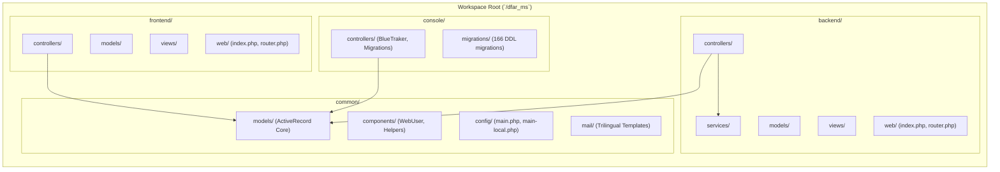
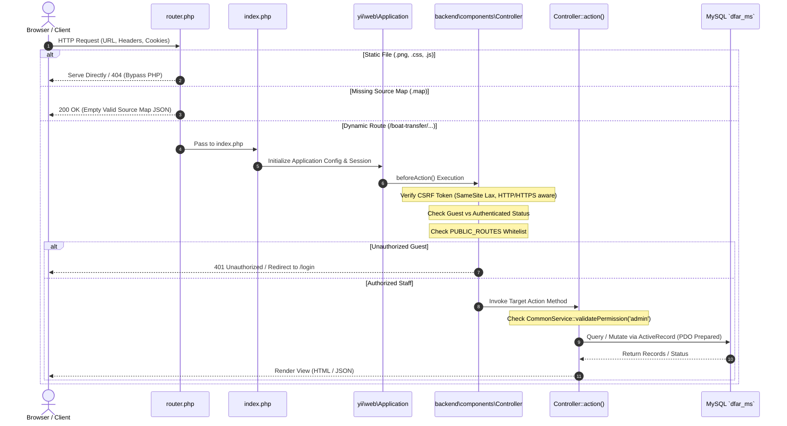
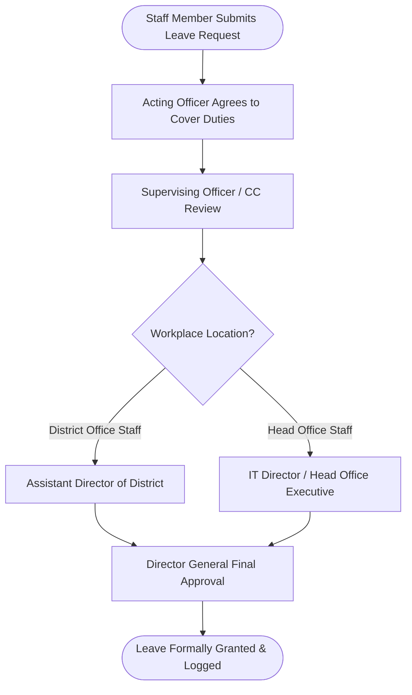
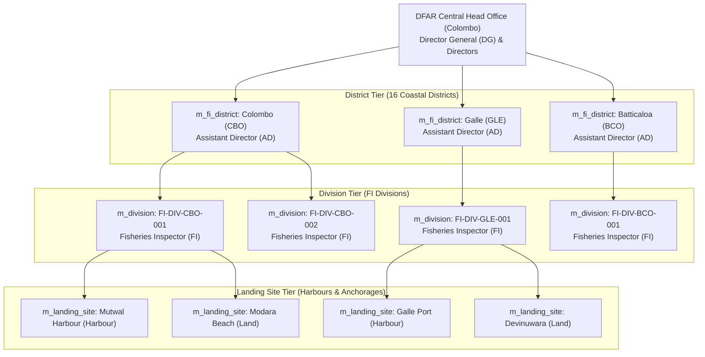
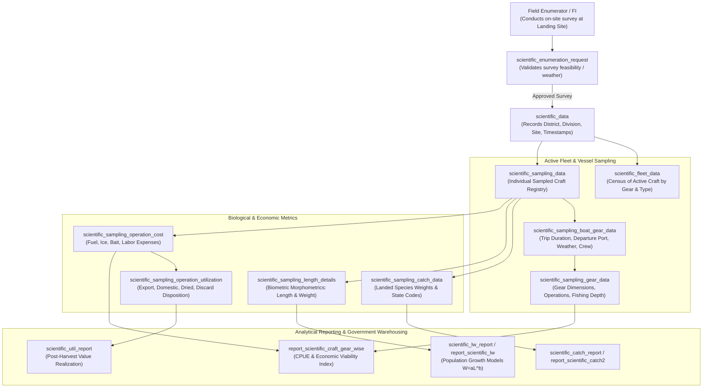

# Department of Fisheries and Aquatic Resources (DFAR)
## System Architecture Diagrams

---

### Document Overview
- **Document Code**: DFAR-DOC-ARCH-04
- **System**: Department of Fisheries and Aquatic Resources Management System (DFAR-MS)
- **Scope**: Structural and physical architecture diagrams, application tiering, component interactions, and deployment topologies.

---

## 1. High-Level Enterprise 3-Tier Architecture

The DFAR system is structured as an enterprise three-tier web application built on the **Yii2 Advanced Framework** architecture, isolating public access, administrative operations, shared business logic, and automated background daemons.

```mermaid
graph TD
    subgraph Client Tier
        PUB_USER["Public Users (Fishermen, Export Companies, Vessel Owners)"]
        OFF_USER["Departmental Staff (FI, AD, DM, DG, Harbour Officers)"]
        EXT_API["External Third Parties & API Consumers"]
    end

    subgraph Web & Presentation Tier (DMZ / Portals)
        FRONTEND["Frontend Public Portal (:8081)<br/>Yii2 Frontend Application<br/>Fisherman Profiles & Self-Service"]
        BACKEND["Backend Admin Management (:8080)<br/>Yii2 Backend Application<br/>Regulatory Operations, Approvals, Dashboards"]
        ROUTER["PHP Built-in / Nginx Reverse Proxy Router<br/>Static Asset Bypass & Error Protection"]
    end

    subgraph Application & Business Logic Tier
        COMMON["Common Shared Library (`/common`)<br/>- ActiveRecord Data Models<br/>- RBAC Auth Middleware<br/>- Validation & Security Enforcers"]
        CONSOLE["Console CLI & Cron Daemons (`/console`)<br/>- `cron.php` Expiration Sweeper<br/>- `BlueTrakerSyncController` (VMS Poller)"]
        SERVICES["Department Service Layer<br/>- CommonService Permission Validator<br/>- LeaveMailer Notification System<br/>- PDF & QR Code Engine (mPDF)"]
    end

    subgraph Data & Storage Tier
        MYSQL[("MySQL 8/9 Enterprise Database<br/>`dfar_ms` (166 Normalized Tables)<br/>InnoDB ACID Storage Engine")]
        UPLOADS[("Protected File System<br/>`/mountpoint/uploads/`<br/>Officer Avatars, Vessel Documents, Inspection Scans")]
    end

    PUB_USER -->|HTTP / HTTPS| ROUTER
    OFF_USER -->|HTTP / HTTPS| ROUTER
    EXT_API -->|REST API Bearer| ROUTER
    ROUTER -->|Port 8081| FRONTEND
    ROUTER -->|Port 8080| BACKEND

    FRONTEND --> COMMON
    BACKEND --> COMMON
    BACKEND --> SERVICES
    CONSOLE --> COMMON

    COMMON --> MYSQL
    SERVICES --> UPLOADS
    CONSOLE --> MYSQL
```

---

## 2. Yii2 Advanced Application Decomposition



---

## 3. Request Lifecycle & Security Middleware Pipeline

Every HTTP request entering the DFAR backend traverses a multi-layered security filter pipeline before reaching controller actions:



---

## 4. Satellite VMS (BlueTraker) Ingress Pipeline

Multi-day vessels transmitting GPS and telemetric reports over satellite relays synchronize with the local database on a continuous schedule:

```mermaid
graph TD
    SAT["Vessel Satellite Transponder<br/>(BlueTraker Maritime Beacon)"]
    GATEWAY["Slovenia / Global BlueTraker API Gateway<br/>(SOAP / REST Web Services)"]
    DAEMON["console/controllers/BlueTrakerSyncController<br/>(Scheduled Daemon Execution)"]
    SYNC_TABLE["`blutracker_api_sync_status`<br/>(Tracks `LastMessageId`)"]
    REPORTS["`bluetraker_reports`<br/>(Normalized Telemetry Store)"]
    DEP_VAL["Departure Clearance Validator<br/>(Checks Speed, Heading, Geofence)"]

    SAT -->|Inmarsat / Iridium Link| GATEWAY
    DAEMON -->|Query High Watermark `LastMessageId`| SYNC_TABLE
    DAEMON -->|HTTP Basic Auth Ingress Request| GATEWAY
    GATEWAY -->>|Batch XML / JSON Telemetry Payload| DAEMON
    DAEMON -->|Bulk INSERT Coordinates & Stats| REPORTS
    DAEMON -->|Update `LastMessageId` Cursor| SYNC_TABLE
    REPORTS --> DEP_VAL
```

---

## 5. Multi-Tier Administrative Leave Approval Chain

The leave management system routes absence applications along strict institutional hierarchies based on workplace assignment and rank:



---

## 6. Fisheries Administrative Hierarchy & Spatial Topology

The territorial administration structure governs how operational jurisdictions flow from Head Office leadership down to individual beach landing points:



---

## 7. Scientific Fisheries Sampling & Research Data Pipeline

The scientific sampling subsystem connects field enumeration events at coastal landing points with national stock assessment models and government export reporting:



