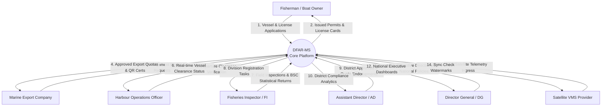
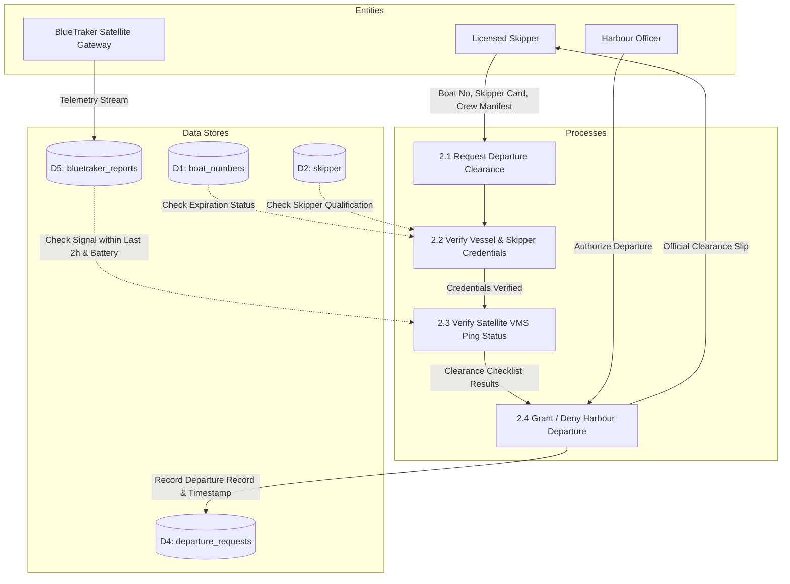
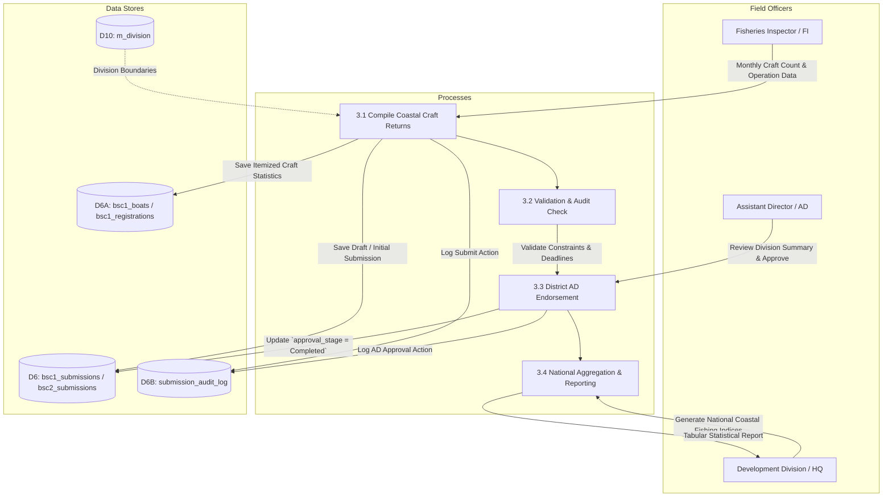

# Department of Fisheries and Aquatic Resources (DFAR)
## Data Flow Diagrams (DFD)

---

### Document Overview
- **Document Code**: DFAR-DOC-DFD-06
- **System**: Department of Fisheries and Aquatic Resources Management System (DFAR-MS)
- **Scope**: Logical data flows, external entities, transformation processes, and data store interactions across key business domains.

---

## 1. DFD Level 0: Context Diagram

The Context Diagram defines the operational boundaries of the DFAR Management System and its interaction with key external actors and external systems:



---

## 2. DFD Level 1: Subsystem Operational Flows

### 2.1 Vessel Registration & Ownership Transfer Flow

```mermaid
graph LR
    subgraph Entities
        OWNER[Vessel Owner]
        FI_OFF[Fisheries Inspector]
        AD_OFF[Assistant Director]
    end

    subgraph Processes
        P1[1.1 Submit Registration Request]
        P2[1.2 Physical Craft Inspection]
        P3[1.3 District Administrative Approval]
        P4[1.4 Ledger Boat Number & Issue Certificate]
    end

    subgraph Data Stores
        D1[(D1: boat_numbers)]
        D2[(D2: boat_number_owners_log)]
        D3[(D3: m_boat_category)]
    end

    OWNER -->|Vessel Specifications & Ownership Deed| P1
    P1 -->|Draft Registration Record| D1
    P1 --> P2
    FI_OFF -->|Dimensions, Engine No, Safety Gear Check| P2
    P2 -->|Inspection Endorsement| D1
    P2 --> P3
    AD_OFF -->|Review & Statutory Fee Clearance| P3
    P3 -->|Approval State (200)| D1
    P3 --> P4
    P4 -->|Write Append-Only Ownership Entry| D2
    D3 -.->|Validate Category| P1
    P4 -->|Official Registration ID| OWNER
```

---

### 2.2 Harbour Departure Clearance Flow



---

### 2.3 BSC Monthly Statistical Returns Flow (BSC1 / BSC2)



---

### 2.4 Scientific Catch Sampling & Field Enumeration Flow

```mermaid
graph TD
    subgraph Field Personnel & Scientists
        ENUM_USER[Field Enumerator / FI]
        SCIENTIST[Senior Marine Biologist / AD]
        RESEARCH[NARA & National Stock Assessment Units]
    end

    subgraph Processes
        P41[4.1 Landing Survey Feasibility Check]
        P42[4.2 Initiate Sampling Session & Fleet Census]
        P43[4.3 Vessel Nautical Profile & Gear Logging]
        P44[4.4 Biological Catch, Biometrics & Cost Capture]
        P45[4.5 Scientific Quality Review & Approval]
        P46[4.6 Analytical Modeling & CPUE Aggregation]
    end

    subgraph Data Stores
        D_GEO[(D8: m_fi_district / m_division / m_landing_site)]
        D_REQ[(D9A: scientific_enumeration_request)]
        D_SESS[(D9B: scientific_data / scientific_fleet_data)]
        D_BIO[(D9C: scientific_sampling_catch / length / cost / util)]
        D_ANL[(D10: scientific_*_report / report_scientific_*)]
    end

    ENUM_USER -->|Check Weather & Fleet Landing Presence| P41
    D_GEO -.->|Spatial Hierarchy (District -> Div -> Site)| P41
    P41 -->|Save Feasibility Record (yes/no)| D_REQ
    P41 -->|If Yes: Launch Field Sampling| P42
    P42 -->|Log Fleet Composition & Craft Selected| D_SESS
    P42 --> P43
    P43 -->|Log Departure Port, Crew, Engine HP, Gear Depth| D_BIO
    P43 --> P44
    P44 -->|Record Species Catch (kg), Length (cm), Costs & Sales| D_BIO
    P44 --> P45
    SCIENTIST -->|Validate Taxonomies & Sampling Integrity| P45
    P45 -->|Set `approval_stage = Approved`| D_SESS
    P45 --> P46
    P46 -->|Populate Materialized Analytical Views & Caches| D_ANL
    D_ANL -->|Stock Assessment Curves & CPUE Reports| RESEARCH
```

---

## 3. Data Store Mapping Reference

| Data Store ID | Table Name | Storage Classification | Primary Mutating Processes |
| :---: | :--- | :--- | :--- |
| **D1** | `boat_numbers` | Transactional Relational | 1.1 New Registration, 1.3 AD Approval, 1.4 Ownership Transfer |
| **D2** | `boat_number_owners_log` | Append-Only Audit | 1.4 Legal Transfer Confirmation |
| **D3** | `national_license` / `highseas_license` | Regulatory Authorization | License Application, Renewal, Revocation |
| **D4** | `departure_requests` | Logistics Ledger | 2.1 Departure Filing, 2.4 Harbour Authorization |
| **D5** | `bluetraker_reports` | Time-Series Telemetry | Background Sync Daemon (Ingress from Satellite Relay) |
| **D6** | `bsc1_submissions` / `bsc2_submissions` | Statistical Returns | 3.1 Field Submission, 3.3 District AD Approval |
| **D7** | `leave` / `leave_approval_history` | Institutional HR Workflow | Leave Application, Acting Signoff, DG Final Approval |
| **D8** | `m_fi_district` / `m_division` / `m_landing_site` | Master Geographical Registries | Spatial Normalization & Jurisdictional Hierarchy (District -> Division -> Landing Site) |
| **D9** | `scientific_data`, `scientific_enumeration_request`, `scientific_sampling_*` | Biological & Bio-Economic Field Sampling | 4.1 Enumeration Feasibility, 4.2 Fleet Census, 4.4 Biometric & Utilization Logging |
| **D10** | `scientific_*_report` / `report_scientific_*` | Analytical Warehousing & Aggregate Views | 4.6 Materialized Analytical Aggregation, CPUE & Stock Modeling |
