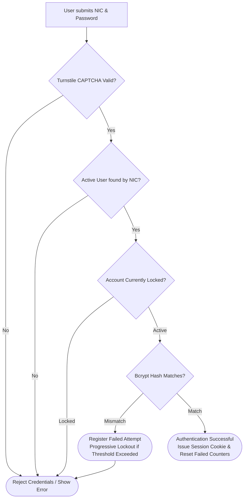

# Department of Fisheries and Aquatic Resources (DFAR)
## User Permission and Access-Control Procedures

---

### Document Overview
- **Document Code**: DFAR-DOC-SEC-08
- **System**: Department of Fisheries and Aquatic Resources Management System (DFAR-MS)
- **Target Audience**: Information Security Officers, System Administrators, Compliance Auditors
- **Security Standard**: Role-Based Access Control (RBAC), Progressive Lockout, CSRF Defense

---

## 1. Authentication Architecture & Credential Management

Authentication in DFAR-MS provides robust identity verification across both public citizens (Fishermen, Exporters) and departmental staff (Fisheries Inspectors, Assistant Directors, Director General):



### 1.1 Password Cryptography
- Passwords are never stored in plain text.
- Passwords are hashed using the **Bcrypt** cryptographic algorithm (`$2y$12$...` cost factor 12) via Yii2's `yii\base\Security::generatePasswordHash()`.
- Password verification is conducted via constant-time verification `password_verify()` to prevent timing side-channel attacks.

### 1.2 Progressive Account Lockout Mechanism
To neutralize brute-force credential stuffing, the system implements a multi-tier progressive lockout tracked directly in the `user` table:

| Consecutive Failed Attempts | Lockout Tier | Lockout Duration | Action Taken |
| :---: | :---: | :---: | :--- |
| **1 - 4** | Warning Tier | None | Counter incremented (`failed_login_attempts++`) |
| **5** | Tier 1 Lockout | **5 Minutes** | Account locked; login attempts rejected with remaining countdown |
| **10** | Tier 2 Lockout | **15 Minutes** | Extended lockout; warning logged to `@runtime/logs/app.log` |
| **15+** | Tier 3 Lockout | **60 Minutes** | High-severity security lockout; administrative review required |

*Note: A successful authentication resets `failed_login_attempts` and `lockout_count` to zero.*

### 1.3 Bot Protection (Cloudflare Turnstile)
The login portal integrates Cloudflare Turnstile token validation in [`SiteController::validateTurnstile()`](file:///Users/mesandasethumika/Desktop/MSDFAR/dfar_ms/backend/controllers/SiteController.php), validating tokens against the configured API secret and rejecting unauthorized hostnames.

---

## 2. Authorization & Access Control Models

The application implements a hybrid authorization model combining **Role-Based Access Control (RBAC)** with **Context-Aware Dynamic Jurisdiction Rules**:

### 2.1 Database RBAC (`yii\rbac\DbManager`)
RBAC permissions are evaluated dynamically using four core tables:
- `auth_item`: Declares roles (type 1) and discrete permissions (type 2 or custom).
- `auth_item_child`: Hierarchical inheritance of permissions between roles.
- `auth_assignment`: Associates individual `user.id` accounts with authorized roles.
- `auth_rule`: Dynamic business rules evaluated during runtime permission checks.

```php
// Standard Enforcement in Controllers
CommonService::validatePermission($this, 'admin');
// Checks if current user has the 'admin' permission or role
```

### 2.2 Base Controller Whitelist (`PUBLIC_ROUTES`)
All controllers in the administrative backend inherit from [`backend\components\Controller`](file:///Users/mesandasethumika/Desktop/MSDFAR/dfar_ms/backend/components/Controller.php). Unauthenticated guest users are strictly prevented from executing any action unless the requested route is explicitly declared in the immutable whitelist:

```php
private const PUBLIC_ROUTES = [
    'site/login',
    'site/signup',
    'site/error',
    'site/captcha',
    'site/request-password-reset',
    'site/reset-password',
    'site/expire',
    'error/index',
    'api/v1/report-website',
    // ... public endpoints
];
```

Any attempt by an unauthenticated user to access a route outside this whitelist immediately throws an `UnauthorizedHttpException` (HTTP 401).

### 2.3 Contextual Approval Jurisdiction (`UserTypeUtil`)
In addition to static RBAC permissions, departmental officers are bound by geographical and organizational jurisdiction:
- **Assistant Directors (AD)**: Can only approve vessels, licenses, and BSC statistical returns registered within their assigned district (`officer_district`).
- **Fisheries Inspectors (FI)**: Can only inspect and submit records within their assigned division (`officer_division`).
- **Leave Routing**: An applicant assigned to a District Office routes their leave to their district's AD, while Head Office personnel route their leave to the IT Director (ITD).

---

## 3. Account Provisioning & Deprovisioning Procedures

### 3.1 New Officer Provisioning Checklist
1. Create official personnel record in `profile_officer` (Full Name, NIC, Designation, Assigned District, Assigned Division).
2. Create user authentication record in `user` table with `status = 10` (Active).
3. Assign the corresponding User Type (`user.type`) matching departmental rank (e.g. `2` for FI, `3` for AD, `4` for DG).
4. Link `user.profile_id` to the newly generated `profile_officer.id`.
5. Insert role bindings into `auth_assignment` granting required RBAC permissions.

### 3.2 Deprovisioning & Access Revocation Procedure
Upon officer retirement, transfer, or termination:
1. Set `user.status = 0` (Deleted / Decommissioned).
2. Invalidate all active session tokens and persistent identity cookies.
3. Remove entries from `auth_assignment` to prevent privilege inheritance.
4. An audit entry is recorded in the administrative log verifying deactivation.
