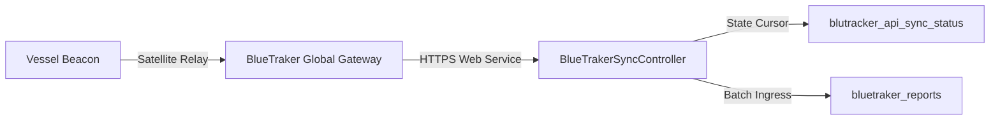

# Department of Fisheries and Aquatic Resources (DFAR)
## System Integration Documentation

---

### Document Overview
- **Document Code**: DFAR-DOC-INT-09
- **System**: Department of Fisheries and Aquatic Resources Management System (DFAR-MS)
- **Target Audience**: Systems Integrators, API Engineers, DevOps Specialists
- **Scope**: External integrations, satellite VMS ingress, public RESTful API endpoints, mail gateways, and QR cryptographic verification.

---

## 1. Satellite Vessel Monitoring System (BlueTraker VMS)

The DFAR system interfaces with the global BlueTraker satellite gateway to ingest continuous positioning, battery, heading, and sensor data from Sri Lankan multi-day offshore vessels (IMUL).

### 1.1 Ingress Architecture
The integration is executed via a dedicated background console worker: [`console/controllers/BlueTrakerSyncController.php`](file:///Users/mesandasethumika/Desktop/MSDFAR/dfar_ms/console/controllers/BlueTrakerSyncController.php).



### 1.2 Configuration Parameters
Managed in `common/config/params.php` / `common/config/params-local.php`:

| Parameter | Configuration Key | Description |
| :--- | :--- | :--- |
| **API Endpoint** | `blueTrackerApiUrl` | BlueTraker SOAP / REST Service URL |
| **Authentication User**| `blueTrackerUsername`| Authorized government gateway account |
| **Authentication Secret**| `blueTrackerPassword`| Secure gateway access secret |
| **Sync Batch Size** | `blueTrackerBatchLimit` | Max telemetry messages ingested per execution |

### 1.3 State Tracking & Watermarking
To ensure zero duplicate ingestion and resilient resumption after network interruptions, the sync cursor stores the highest processed message identifier:
- High-water mark stored in: `blutracker_api_sync_status.LastMessageId`.
- Ingress queries: `GET /messages?fromMessageId={LastMessageId}`.
- Upon successful database transaction commit, `LastMessageId` increments to the latest batch watermark.

---

## 2. Departmental SMTP Mail Gateway Integration

The system communicates automated notifications, leave approval alerts, and password reset instructions via the Ministry of Fisheries authenticated SMTP server:

```php
'components' => [
    'mailer' => [
        'class' => 'yii\swiftmailer\Mailer',
        'viewPath' => '@common/mail',
        'useFileTransport' => false,
        'transport' => [
            'class' => 'Swift_SmtpTransport',
            'host' => 'mail.fisheriesdept.gov.lk',
            'username' => 'departure1@fisheriesdept.gov.lk',
            'password' => 'DFAR@123654', // Production vault credential
            'port' => '587',
            'encryption' => 'tls',
        ],
    ],
]
```

### Notification Types
1. **Leave Approval Routing**: Notifies Acting Officers, Supervising Officers (CC), Assistant Directors, and the Director General upon pending leave requests.
2. **Password Reset Tokens**: Transmits cryptographic reset URLs with strict 300-second expiration timers.

---

## 3. Public & Inter-Agency RESTful API Subsystem

DFAR-MS exposes a suite of secured REST APIs under the `/api/v1/` namespace to support inter-agency information sharing with the Sri Lanka Navy, Coast Guard, Ministry of Defence, and customs authorities:

```mermaid
graph LR
    CLIENT["External Agency Client"] -->|HTTP GET / POST + API Key| API_GATEWAY["DFAR API Router"]
    API_GATEWAY --> AUTH_CHECK{"Valid API Key & Client?"}
    AUTH_CHECK -->|Denied| RES_401["401 Unauthorized Response"]
    AUTH_CHECK -->|Approved| LOG_REQ["`api_request_logs` Entry"]
    LOG_REQ --> EXEC_ACT["Execute Controller Action"]
    EXEC_ACT --> JSON_RES["Standardized JSON Response"]
```

### 3.1 Published Endpoints

| Endpoint | Method | Authentication | Purpose |
| :--- | :---: | :---: | :--- |
| `/api/v1/report-website` | `GET` | Public / Token | Public summary of registered vessels and catch indices. |
| `/api/v1/catch-production` | `GET` | Bearer Token | Aggregated national marine catch production statistics. |
| `/api/v1/get-boat-departure-by-id`| `GET` | Bearer Token | Real-time departure clearance lookup for naval patrols. |
| `/api/v1/update-vms-payment` | `POST` | Signed Token | Webhook receiving confirmation of satellite service fees. |
| `/api/v1/production-data` | `GET` | Bearer Token | Time-series fisheries production metrics. |
| `/api/v1/boat-data-by-harbour` | `GET` | Bearer Token | Active craft stationed at a designated fishing harbour. |

### 3.2 API Security Tables
- `api_clients`: Registered agency client entities with contact metadata and status.
- `api_keys`: Cryptographic client access keys and tokens.
- `api_endpoints`: Directory of protected system endpoints and rate limits.
- `api_key_permissions`: Matrix binding client keys to permitted routes.
- `api_request_logs`: Ingress log storing caller IP, request payload, response status, and latency.

---

## 4. Document Authenticity & QR Verification Engine

All licenses, skipper qualification cards, and export permits produced by DFAR-MS include an embedded cryptographic QR code to facilitate on-site verification by naval patrols, harbor masters, and foreign port authorities:

1. **QR Generation**: Rendered using the `Da\QrCode\QrCode` library embedded directly into high-resolution PDF documents produced via `mPDF`.
2. **Validation Route**: The QR code encodes a secure URL pointing to:
   ```
   https://msdfar.com/site/license-validation?hash={CRYPTOGRAPHIC_VERIFICATION_TOKEN}
   ```
3. **Public Validation Verification**: The validation endpoint queries the immutable license ledger and renders an official verification banner showing vessel name, registration number, validity dates, authorized fishing gear, and compliance status.
