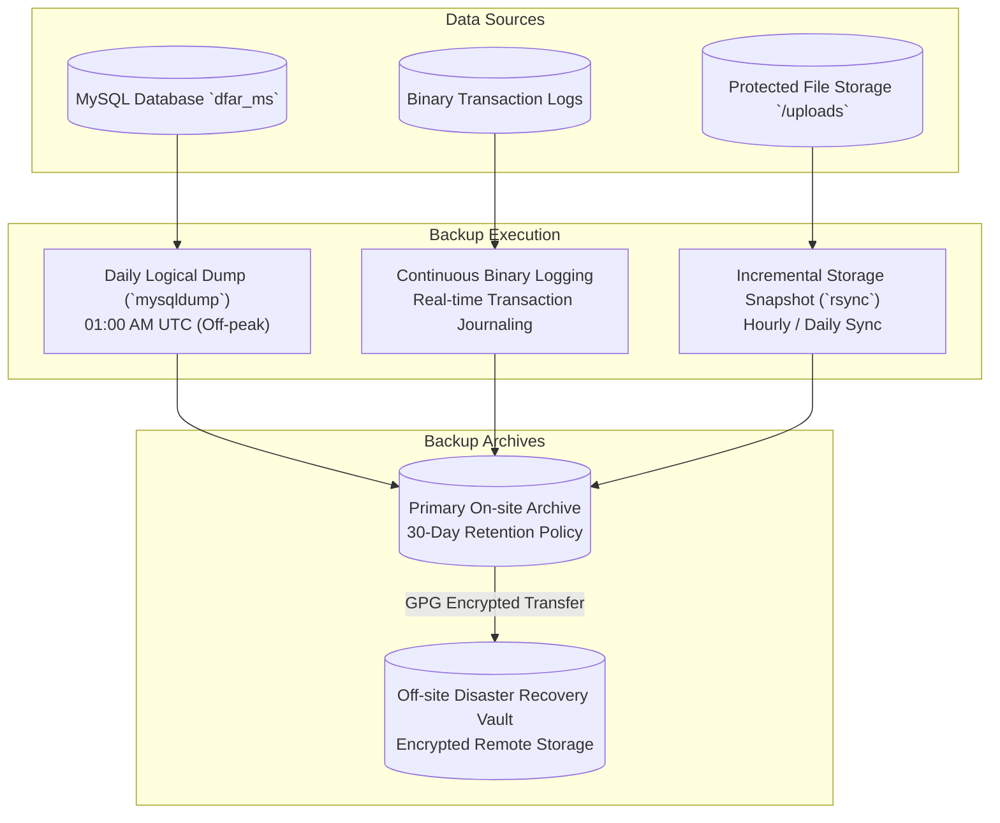

# Department of Fisheries and Aquatic Resources (DFAR)
## Backup, Recovery, and Maintenance Procedures

---

### Document Overview
- **Document Code**: DFAR-DOC-OPS-10
- **System**: Department of Fisheries and Aquatic Resources Management System (DFAR-MS)
- **Target Audience**: Systems Administrators, DBAs, DevOps Engineers, Disaster Recovery Teams
- **Standard**: High Availability, Point-In-Time Recovery (PITR), Automated Maintenance

---

## 1. Backup Strategy & Scheduling

The DFAR system maintains an automated multi-tier backup policy to ensure zero data loss across regulatory vessel records, licenses, and satellite telemetry:



### 1.1 Backup Schedules & Specifications

| Tier | Target Asset | Frequency | Tool / Method | Retention Policy |
| :--- | :--- | :---: | :--- | :---: |
| **Full DB Dump** | `dfar_ms` database | Daily @ 01:00 AM | `mysqldump --single-transaction --routines` | 30 Days (Daily), 12 Months (Monthly) |
| **Point-In-Time** | Binary Logs | Continuous | MySQL Binary Log (`mysql-bin.xxxxxx`) | 14 Days rolling |
| **Media & Files** | `/uploads/` folder | Daily @ 02:00 AM | `rsync -avz --delete` | 60 Days |
| **System Config** | Configuration files| Weekly / on change | Git repository commits & encrypted config vaults | Indefinite |

### 1.2 Automated Database Dump Command

The backup script utilizes `--single-transaction` to create non-blocking, consistent dumps of InnoDB tables without locking active web operations:

```bash
#!/usr/bin/env bash
TIMESTAMP=$(date +"%Y%m%d_%H%M%S")
BACKUP_DIR="/var/backups/dfar_ms"
mkdir -p "$BACKUP_DIR"

# Execute consistent logical dump with compression
mysqldump -u dfar_backup -p'SECURE_BACKUP_PASSWORD' \
  --single-transaction \
  --quick \
  --routines \
  --triggers \
  --events \
  dfar_ms | gzip > "$BACKUP_DIR/dfar_ms_$TIMESTAMP.sql.gz"

# Retain last 30 days of archives
find "$BACKUP_DIR" -type f -name "dfar_ms_*.sql.gz" -mtime +30 -exec rm {} \;
```

---

## 2. Disaster Recovery & Restoration Procedures

### 2.1 Full Database Restoration Runbook

In the event of hardware failure, database corruption, or system migration:

1. **Provision Fresh Database**:
   ```sql
   DROP DATABASE IF EXISTS dfar_ms;
   CREATE DATABASE dfar_ms CHARACTER SET utf8mb4 COLLATE utf8mb4_unicode_ci;
   ```

2. **Restore Latest Compressed Dump**:
   ```bash
   gunzip < /var/backups/dfar_ms/dfar_ms_20261013_010000.sql.gz | mysql -u root -p dfar_ms
   ```

3. **Replay Binary Logs (Point-In-Time Recovery to Specific Second)**:
   ```bash
   mysqlbinlog --stop-datetime="2026-10-13 10:45:00" \
     /var/log/mysql/mysql-bin.000142 \
     /var/log/mysql/mysql-bin.000143 | mysql -u root -p dfar_ms
   ```

4. **Execute Post-Restoration Migrations**:
   Ensure all recently committed schema migrations are verified and applied:
   ```bash
   cd /path/to/MSDFAR/dfar_ms
   php yii migrate --interactive=0
   ```

5. **Flush Application Cache**:
   ```bash
   php yii cache/flush-all
   php yii cache/flush-schema
   ```

---

## 3. Routine System Maintenance Operations

### 3.1 Automated Daily Cron Jobs
The system includes maintenance tasks triggered via scheduled cron daemons:

1. **Expiration Sweeper (`cron.php`)**:
   - Executes daily at midnight:
     ```bash
     0 0 * * * /usr/bin/php /path/to/MSDFAR/dfar_ms/cron.php >> /var/log/dfar_cron.log 2>&1
     ```
   - Invokes endpoint `/site/expire` to automatically update expired temporary licenses, reset overdue departure flags, and clean expired password tokens.

2. **BlueTraker VMS Synchronizer**:
   - Executes every 15 minutes:
     ```bash
     */15 * * * * /usr/bin/php /path/to/MSDFAR/dfar_ms/yii blue-traker-sync >> /var/log/dfar_vms.log 2>&1
     ```

### 3.2 Log Rotation & Monitoring
Application logs stored in `backend/runtime/logs/app.log` are rotated automatically by Yii2's `FileTarget` (`maxFileSize = 10240 KB`, `maxLogFiles = 5`). System log rotation (`logrotate`) archives rotated logs to compressed cold storage monthly.

### 3.3 Database Health Checks & Optimization
To maintain B-Tree index density and optimize query plans, DBAs execute monthly table optimizations:

```sql
OPTIMIZE TABLE boat_numbers;
OPTIMIZE TABLE national_license;
OPTIMIZE TABLE departure_requests;
OPTIMIZE TABLE bluetraker_reports;
OPTIMIZE TABLE bsc1_submissions;
```
