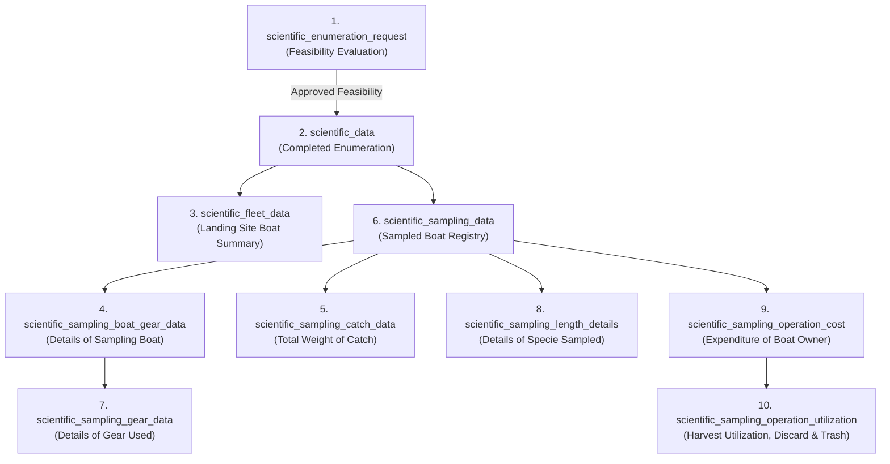

# Department of Fisheries and Aquatic Resources (DFAR)
## Scientific Sampling Database Technical Specification

---

### Document Overview
- **Document Code**: DFAR-DOC-SCI-12
- **System**: Department of Fisheries and Aquatic Resources Management System (DFAR-MS)
- **Domain**: Marine Scientific Catch Sampling & Enumeration Subsystem
- **Audience**: Field Enumerators, Fisheries Inspectors (FI), Senior Marine Biologists, Database Administrators

---

## Executive Summary

The scientific sampling subsystem collects biological, biometric, catch-effort, vessel profile, voyage expenditure, and post-harvest economic utilization data from landing sites across Sri Lanka. The subsystem is structured into the following **10 core database tables**:

```
1. scientific_enumeration_request
   └─ Asking whether the enumerator can carry out the enumeration or not

2. scientific_data
   └─ Details of the completed enumeration

3. scientific_fleet_data
   └─ Summary of the boats operated in the landing site

4. scientific_sampling_boat_gear_data
   └─ Details of the sampling boat

5. scientific_sampling_catch_data
   └─ Total weight of the catch by the particular sampling boat

6. scientific_sampling_data
   └─ Relevant scientific record submitted from this boat

7. scientific_sampling_gear_data
   └─ Details of the gear used in the particular sampling boat

8. scientific_sampling_length_details
   └─ Details of the specie sampled

9. scientific_sampling_operation_cost
   └─ Expenditure data of the boat owner

10. scientific_sampling_operation_utilization
    └─ Details on how the harvest is utilized, discarded and trashed
```

---

## 1. `scientific_enumeration_request`
> **Asking whether the enumerator can carry out the enumeration or not**

Records pre-enumeration feasibility evaluations by field enumerators upon arriving at coastal landing sites. Captures incident reporting when sampling cannot proceed due to adverse weather or zero fleet activity.

### Field Specification
| Field Name | Type | Key | Description |
| :--- | :--- | :---: | :--- |
| `id` | `int` | **PK** | Unique enumeration request identifier |
| `user` | `int` | **FK** | User ID of the assigned field enumerator (`user.id`) |
| `request_date` | `date` | | Planned date for field enumeration |
| `date` | `datetime` | | Precise timestamp when survey feasibility was evaluated |
| `can_continue` | `varchar(100)` | | Boolean status indicator (`yes` or `no`) |
| `reason` (`reson`)| `varchar(200)` | | Justification if enumeration was aborted (e.g. *Bad weather*, *No landings*) |
| `status` | `int` | | Request record status flag |
| `district` | `int` | **FK** | Target Fisheries District ID (`m_fi_district.id`) |
| `division` | `int` | **FK** | Target Fisheries Inspector Division ID (`m_division.id`) |
| `landing_site` | `int` | **FK** | Target coastal landing point ID (`m_landing_site.id`) |

---

## 2. `scientific_data`
> **Details of the completed enumeration**

The master container record for an executed scientific sampling session conducted by an authorized enumerator or Fisheries Inspector.

### Field Specification
| Field Name | Type | Key | Description |
| :--- | :--- | :---: | :--- |
| `id` | `int` | **PK** | Unique scientific sampling session ID |
| `district` | `int` | **FK** | Administrative Fisheries District (`m_fi_district.id`) |
| `division` | `int` | **FK** | Administrative FI Division (`m_division.id`) |
| `landing_site` | `int` | **FK** | Physical coastal landing site / harbour (`m_landing_site.id`) |
| `start_time` | `datetime` | | Timestamp when enumeration sampling commenced |
| `end_time` | `datetime` | | Timestamp when enumeration sampling concluded |
| `added_by` | `int` | **FK** | Officer / Enumerator user ID who logged the session |
| `status` | `int` | | Session lifecycle status |
| `approval_stage`| `varchar(50)` | | Regulatory approval milestone (`Pending`, `Approved`, `Rejected`) |
| `inspected_by` | `int` | **FK** | Supervising Marine Biologist or Assistant Director ID |

---

## 3. `scientific_fleet_data`
> **Summary of the boats operated in the landing site**

Captures a census summary of all fishing craft observed operating at the landing site during the survey period, classified by hull type, sub-category, and deployed fishing gear.

### Field Specification
| Field Name | Type | Key | Description |
| :--- | :--- | :---: | :--- |
| `id` | `int` | **PK** | Unique fleet summary record ID |
| `scientific_id` | `int` | **FK** | Foreign key linking to parent session `scientific_data.id` |
| `boat_type` | `int` | **FK** | Craft category classification (`m_boat_types.id`: IMUL, IDAY, OFRP, etc.) |
| `sub_category` | `int` | **FK** | Boat dimensional subcategory (`m_boat_sub_category.id`) |
| `gear_type` | `int` | **FK** | Standardized fishing gear code (`m_gear_types.id`) |
| `no_of_boats` | `int` | | Total observed count of active boats in this category |
| `status` | `int` | | Active status flag |

---

## 4. `scientific_sampling_boat_gear_data`
> **Details of the sampling boat**

Detailed profile of the specific vessel sampled, including voyage duration, crew complement, departure logistics, engine power, and sea state.

### Field Specification
| Field Name | Type | Key | Description |
| :--- | :--- | :---: | :--- |
| `id` | `int` | **PK** | Boat sampling profile record ID |
| `sampling_data_id`| `int` | **FK** | References sampled vessel record `scientific_sampling_data.id` |
| `fishey_type` | `int` | **FK** | Marine fishery type classification |
| `sub_category` | `int` | **FK** | Boat hull sub-category (`m_boat_sub_category.id`) |
| `engine_hp` | `varchar(11)` | | Propulsion engine horsepower rating |
| `departure_date` | `date` | | Date vessel originally put to sea |
| `departure_time` | `time` | | Time of departure from port |
| `departure_district`| `int` | **FK** | Departure coastal district (`m_fi_district.id`) |
| `departure_division`| `int` | **FK** | Departure FI division (`m_division.id`) |
| `depature_port` | `int` | **FK** | Departure port or landing site (`m_landing_site.id`) |
| `weather` | `varchar(200)` | | Marine meteorological and sea state conditions |
| `arrival_date` | `date` | | Date vessel returned to landing site |
| `remark` | `varchar(200)` | | Field observer remarks and qualitative notes |
| `crew_members_count`| `int` | | Total number of crew personnel aboard |
| `unloading_type`| `varchar(200)` | | Catch discharge methodology (Manual, Crane, Chilled crate) |
| `gear_setting_time`| `varchar(100)` | | Average duration required to deploy gear array |
| `days` | `int` | | Total voyage duration in days |
| `hours` | `int` | | Residual voyage duration in hours |
| `status` | `int` | | Status indicator |

---

## 5. `scientific_sampling_catch_data`
> **Total weight of the catch by the particular sampling boat**

Itemized catch volume landed by the sampled vessel, disaggregated by species and gear type with condition weight codes.

### Field Specification
| Field Name | Type | Key | Description |
| :--- | :--- | :---: | :--- |
| `id` | `int` | **PK** | Catch measurement entry ID |
| `craft_id` | `int` | **FK** | Sampled vessel / voyage identifier |
| `specie` | `int` | **FK** | Biological species code (`m_fish_types.id`) |
| `gear` | `int` | **FK** | Fishing gear used to harvest the specimen (`m_gear_types.id`) |
| `weight_code` | `int` | | Landed state code (1=Whole, 2=Gutted, 3=Gilled & Gutted, 4=Headed) |
| `weight` | `double` | | Total catch weight landed by this boat (kg) |

---

## 6. `scientific_sampling_data`
> **Relevant scientific record submitted from this boat**

Links the top-level sampling session (`scientific_data`) to an individual physical vessel identified by its national registration number.

### Field Specification
| Field Name | Type | Key | Description |
| :--- | :--- | :---: | :--- |
| `id` | `int` | **PK** | Sampled vessel instance ID |
| `scientific_id` | `int` | **FK** | Foreign key pointing to parent session `scientific_data.id` |
| `boat_number` | `varchar(200)` | | Official registration number of the sampled fishing boat |
| `status` | `int` | | Sample status flag |

---

## 7. `scientific_sampling_gear_data`
> **Details of the gear used in the particular sampling boat**

Technical operational parameters of the fishing gears deployed during the voyage, capturing operating depths, active soaking periods, and fishing effort units.

### Field Specification
| Field Name | Type | Key | Description |
| :--- | :--- | :---: | :--- |
| `id` | `int` | **PK** | Gear deployment entry ID |
| `boat_data_id` | `int` | **FK** | References voyage record `scientific_sampling_boat_gear_data.id` |
| `gear` | `int` | **FK** | Gear type identifier (`m_gear_types.id`) |
| `target_species`| `int` | **FK** | Primary target commercial species (`m_fish_types.id`) |
| `operations_per_trip`| `int` | | Number of fishing sets/shots executed during voyage |
| `fishing_time_days` | `double` | | Active fishing duration in days |
| `fishing_time_hours`| `double` | | Active fishing duration in hours |
| `fishing_depth` | `double` | | Operating depth of gear (meters / fathoms) |
| `g_code` | `int` | | Standard statistical gear classification code |
| `extra` | `varchar(500)` | | Detailed gear parameters (mesh size, hook count, line length) |
| `type` | `varchar(100)` | | Gear category (`Primary`, `Secondary`) |
| `status` | `int` | | Operational status |

---

## 8. `scientific_sampling_length_details`
> **Details of the specie sampled**

Specimen-level biometric and morphometric measurements utilized by marine biologists for length-frequency analysis, stock assessment, and growth modeling.

### Field Specification
| Field Name | Type | Key | Description |
| :--- | :--- | :---: | :--- |
| `id` | `int` | **PK** | Specimen measurement ID |
| `sampling_data_id`| `int` | **FK** | References sampled vessel record `scientific_sampling_data.id` |
| `gear` | `int` | **FK** | Gear type used (`m_gear_types.id`) |
| `specie` | `int` | **FK** | Marine fish species (`m_fish_types.id`) |
| `specie_count` | `int` | | Count of individual specimens measured in this size class |
| `weight` | `double` | | Aggregate or specimen weight in kilograms (kg) |
| `weight_code` | `int` | | Processing condition state code |
| `length_type` | `int` | | Morphometric metric: 1=Total Length (TL), 2=Fork Length (FL), 3=Standard (SL) |
| `length_code` | `int` | | Unit of measurement: 1=Centimetres (`cm`), 2=Millimetres (`mm`) |
| `length` | `double` | | Numerical specimen length measured |
| `status` | `int` | | Data validation status |

---

## 9. `scientific_sampling_operation_cost`
> **Expenditure data of the boat owner**

Economic profiling of voyage operational expenditures incurred by vessel operators, essential for Catch Per Unit Effort (CPUE) bio-economic modeling.

### Field Specification
| Field Name | Type | Key | Description |
| :--- | :--- | :---: | :--- |
| `id` | `int` | **PK** | Expenditure ledger entry ID |
| `fuel_qty` | `double` | | Fuel consumed during trip (litres) |
| `fuel_price` | `double` | | Total expenditure on diesel / kerosene / petrol (LKR) |
| `ice_qty` | `double` | | Chilling ice used (blocks / kg) |
| `ice_price` | `double` | | Total expenditure on ice preservation (LKR) |
| `bait_qty` | `double` | | Bait quantity used (kg) |
| `bait_price` | `double` | | Total expenditure on natural / artificial bait (LKR) |
| `labour_cost` | `double` | | Crew wages, provisions share, or labor remuneration (LKR) |
| `food_water` | `double` | | Food rations and potable drinking water expenses (LKR) |
| `other` | `double` | | Miscellaneous voyage costs (LKR) |
| `remark` | `varchar(500)` | | Financial evaluator remarks |
| `sampling_data_id`| `int` | **FK** | References sampled boat `scientific_sampling_data.id` |

---

## 10. `scientific_sampling_operation_utilization`
> **Details on how the harvest is utilized, discarded and trashed**

Tracks post-harvest disposition of landed fish across commercial revenue channels, domestic consumption, preservation, discards, and fishmeal reduction.

### Field Specification
| Field Name | Type | Key | Description |
| :--- | :--- | :---: | :--- |
| `id` | `int` | **PK** | Harvest disposition ledger ID |
| `operation_cost_id`| `int` | **FK** | References parent sampling session or economic ledger |
| `specie` | `int` | **FK** | Marine fish species (`m_fish_types.id`) |
| `export_qty` | `double` | | Volume channeled to international export processing (kg) |
| `export_value` | `double` | | Commercial revenue realized from export sales (LKR) |
| `local_qty` | `double` | | Volume auctioned in domestic fresh fish markets (kg) |
| `local_value` | `double` | | Revenue realized from local fresh market auctions (LKR) |
| `dried_qty` | `double` | | Volume redirected to dry fish and salting processors (kg) |
| `dried_value` | `double` | | Market value of dry fish product (LKR) |
| `discard_qty` | `double` | | Non-commercial or unmarketable bycatch discarded at sea (kg) |
| `discard_value` | `double` | | Estimated economic loss from discarded catch (LKR) |
| `trash` | `int` | | Indicator flag for trash fish / reduction to animal feed (1=Yes, 0=No) |
| `status` | `int` | | Record status |

---

## 11. Relational Entity Flow Architecture


