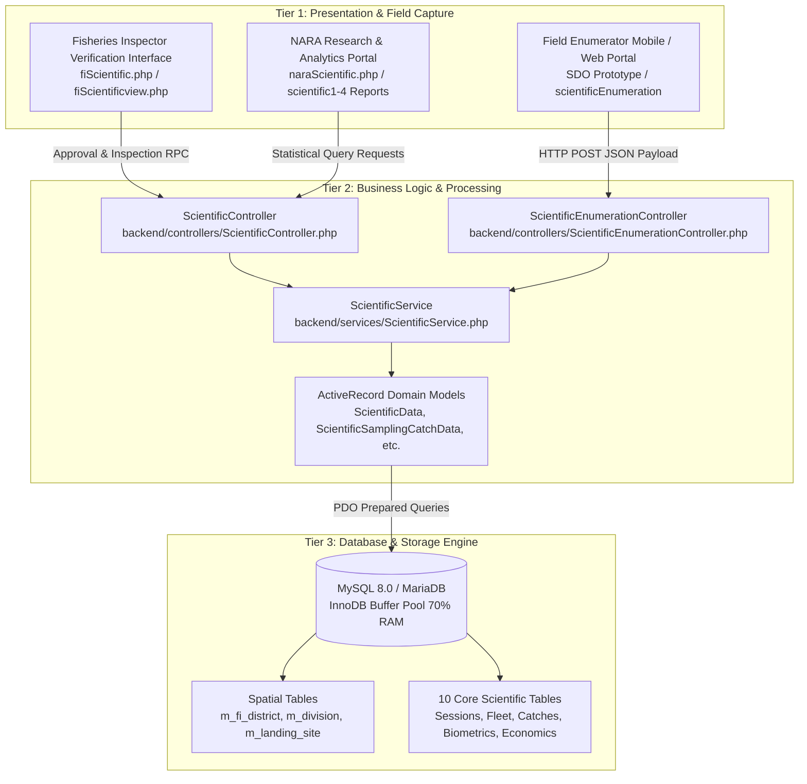
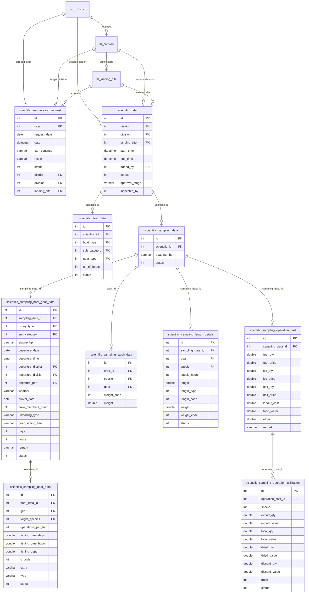
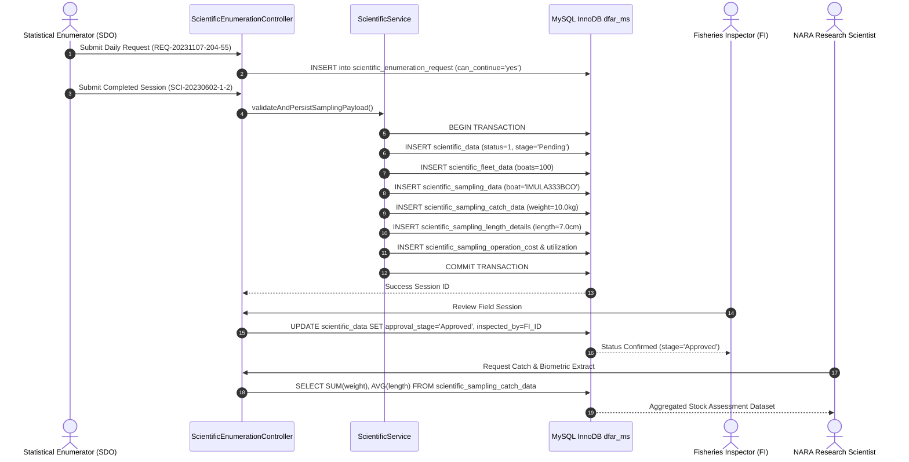

# Department of Fisheries and Aquatic Resources (DFAR)
# Scientific Sampling Subsystem: System Architecture Diagrams

---

### Document Overview
- **Document Code**: DFAR-SCI-DOC-ARCH-04
- **Domain**: Marine Scientific Catch Sampling & Enumeration Subsystem
- **Scope**: Comprehensive architectural, topological, relational, and component diagrams exclusively representing the Scientific section of the DFAR Management System.

---

## 1. 3-Tier Subsystem Enterprise Architecture

The Scientific Sampling Subsystem is organized in three decoupled tiers:

---

## 2. Complete Scientific Relational Entity-Relationship Diagram (ERD)

The diagram below reflects the exact foreign key linkages and physical structure of the production database:

---

## 3. Scientific Subsystem Security & Data Flow Pipeline

