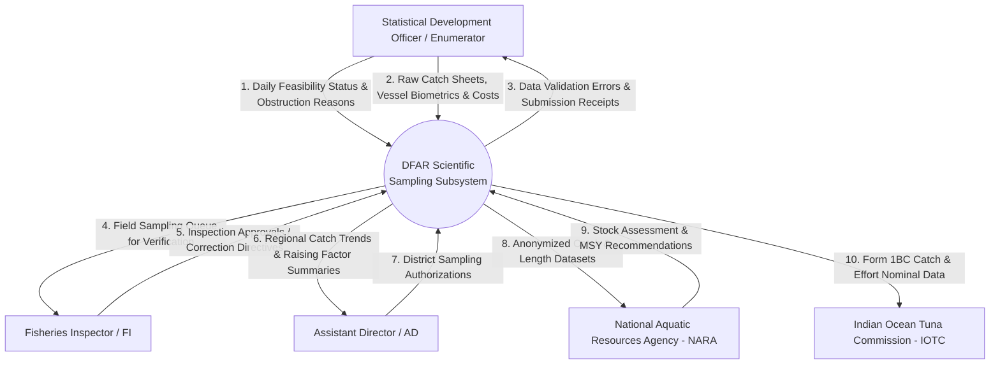
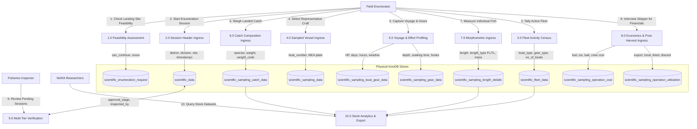
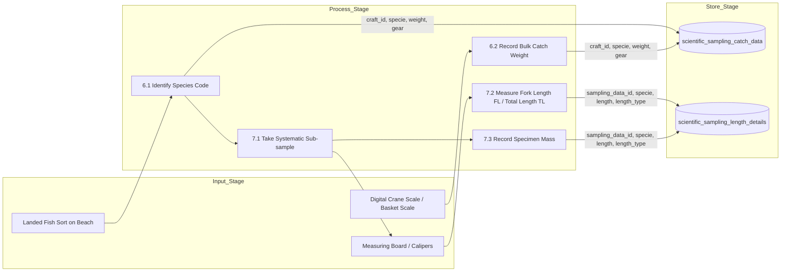

# Department of Fisheries and Aquatic Resources (DFAR)
# Scientific Sampling Subsystem: Data Flow Diagrams (DFD)

---

### Document Overview
- **Document Code**: DFAR-SCI-DOC-DFD-06
- **Domain**: Marine Scientific Catch Sampling & Enumeration Subsystem
- **Scope**: Logical and physical data flow diagrams (Level 0 Context, Level 1 Subsystem, and Level 2 Functional Decompositions) exclusively mapping the Scientific Sampling and Enumeration Subsystem.

---

## 1. DFD Level 0: Context Diagram (Scientific Subsystem Boundary)

The Context Diagram establishes the operational boundaries of the Scientific Sampling Subsystem and its data exchanges with field officers, regional regulators, national research bodies, and international treaty secretariats:

---

## 2. DFD Level 1: Subsystem Operational Data Flows

The Level 1 diagram decomposes the internal data transformation processes across the 10 core scientific data stores:

---

## 3. DFD Level 2: Detailed Catch & Biometrics Ingress Flow

