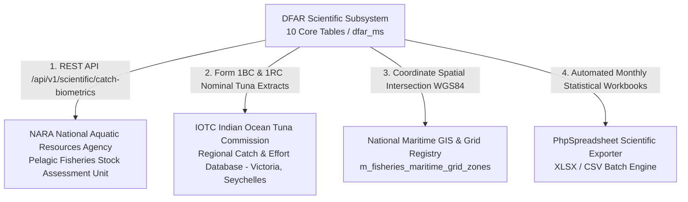

# Department of Fisheries and Aquatic Resources (DFAR)
# Scientific Sampling Subsystem: System Integration Documentation

---

### Document Overview
- **Document Code**: DFAR-SCI-DOC-INT-09
- **Domain**: Marine Scientific Catch Sampling & Enumeration Subsystem
- **Scope**: System integration specifications, external research interfaces, treaty compliance pipelines (NARA, IOTC), geographic GIS bindings, and automated statistical data export contracts.

---

## 1. Integration Landscape & Ecosystem

The Scientific Sampling Subsystem integrates with national marine institutes, regional fisheries bodies, and spatial registries:



---

## 2. NARA Research Interface Data Contract

The National Aquatic Resources Research and Development Agency (NARA) accesses verified scientific sampling data for stock assessments via secured JSON REST API:

- **Endpoint**: `GET /api/v1/scientific/stock-data`
- **Authentication**: Bearer API Token (`X-NARA-API-KEY`)
- **Query Parameters**:
  - `start_date` (ISO-8601: `YYYY-MM-DD`)
  - `end_date` (ISO-8601: `YYYY-MM-DD`)
  - `district_id` (Integer, Optional)
  - `species_id` (Integer, Optional)

### Sample JSON Payload Response
```json
{
  "status": "success",
  "generated_at": "2026-10-15T11:35:00+05:30",
  "total_records": 194,
  "data": [
    {
      "session_id": 2,
      "date": "2023-06-02",
      "district": "Batticaloa",
      "landing_site": "Kallady Beach",
      "sampled_vessel": "IMULA333BCO",
      "engine_hp": 22,
      "voyage_days": 3,
      "gear": "Gillnet",
      "species": "Thunnus albacares",
      "landed_weight_kg": 10.0,
      "biometrics": [
        {"length_cm": 7.0, "length_type": "FL", "weight_g": 4.0}
      ]
    }
  ]
}
```

---

## 3. IOTC Treaty Compliance & Reporting Standards

Sri Lanka is a contracting party to the **Indian Ocean Tuna Commission (IOTC)** and legally mandates the submission of empirical catch and effort datasets under IOTC Resolutions 15/01 and 15/02:

1. **IOTC Form 1BC (Catch and Effort by Vessel / Gear)**:
   - Aggregates `scientific_sampling_catch_data.weight` cross-referenced with `scientific_sampling_boat_gear_data.days` and `scientific_sampling_gear_data.fishing_time_hours`.
2. **IOTC Form 1RC (Length-Frequency Sampling)**:
   - Exports disaggregated length bins from `scientific_sampling_length_details` where `length_type = 1` (Fork Length) with 2cm interval distributions.

---

## 4. Geographic Information System (GIS) Grid Binding

Landing sites in `m_landing_site` are spatially joined with `m_fisheries_maritime_grid_zones` to convert beach landings into spatial maritime polygon data:
- GPS Latitude and Longitude from designated landing centers are projected into 1-degree by 1-degree IOTC statistical grids.
- Provides spatial heatmaps of coastal catch distributions around Sri Lanka's 1,770 km coastline.
